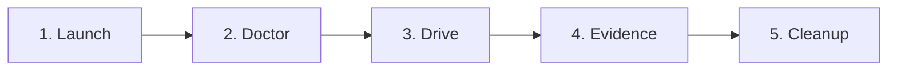

---

name: verify-tanstack-open-api
description: Automated runtime verification skill for tanstack-open-api across all core user journeys, SSE streams, SSR guards, and telemetry headers.
---

# Runtime Verification: `tanstack-open-api`

This skill defines the canonical 5-phase runtime verification loop (`Launch`, `Doctor`, `Drive`, `Evidence`, `Cleanup`) to validate `tanstack-open-api` against a running application instance. It must be executed before opening a PR or claiming a feature is complete.

---

## The Verification Loop



### Phase 1: Launch

1. **Verify or Start Upstream Backend (`hono-open-api`)**:
   Ensure the backend is running on `http://localhost:9999` (or start via Docker Compose / `pnpm dev` in the backend workspace):

   ```bash
   curl -fsS http://localhost:9999/health || echo "Backend offline"
   ```
2. **Start Frontend Dev Server**:

   ```bash
   pnpm dev --port 3000 &
   FRONTEND_PID=$!
   ```
3. **Wait for Port 3000**:

   ```bash
   npx wait-on http://127.0.0.1:3000/health || sleep 2
   ```

### Phase 2: Doctor

Run read-only pre-flight sanity checks:

1. **Health Check**:

   ```bash
   curl -i http://localhost:3000/health
   # Assert HTTP 200 OK and {"status":"ok"}
   ```
2. **SSR Smoke Check**:

   ```bash
   curl -s http://localhost:3000/showcase | grep -i "<!DOCTYPE html>"
   # Assert valid SSR HTML document with pre-rendered markup
   ```
3. **API Proxy Connectivity**:

   ```bash
   curl -i http://localhost:3000/api/health || true
   # Assert reverse proxy routes correctly to upstream backend
   ```

### Phase 3: Drive (5 Core Feature Flows)

Execute verification procedures across the 5 core feature flows documented in `features/`:

1. **`showcase-and-theming`** (`features/showcase-and-theming.md`):
   - Navigate to `/showcase`.
   - Test theme switcher cycling (`warm-tactile`, `editorial-slate`, `neo-brutalist`).
   - Verify OKLCH color rendering, `shadow-tactile` and `interactive-tactile` elevation physics.
   - Verify input fields, buttons, badges, tables, and dialog primitives.
2. **`auth-and-rbac`** (`features/auth-and-rbac.md`):
   - Navigate to `/login`.
   - Test authentication with test credentials.
   - Verify SSR header forwarding (`cookie` and `authorization`).
   - Verify session caching via `authSessionQueryOptions`.
   - Verify pathless `_app.tsx` guard redirection and `<Can />` RBAC element rendering.
3. **`live-tasks`** (`features/live-tasks.md`):
   - Navigate to `/tasks`.
   - Create a task and toggle completion with optimistic UI update.
   - Verify SSE connection to `/api/v1/tasks/live`.
   - Verify mutation buffering while `["tasks", "mutation"]` is in-flight.
   - Delete task and confirm optimistic removal and SSE delta sync.
4. **`files-upload-and-download`** (`features/files-upload-and-download.md`):
   - Navigate to `/files`.
   - Test direct multipart file upload to `/api/v1/files/upload`.
   - Test 3-step presigned upload (`POST /presign` $\to$ `PUT` storage with progress bar $\to$ `POST /complete`).
   - Trigger authenticated file download and verify binary stream integrity.
5. **`observability-and-headers`** (`features/observability-and-headers.md`):
   - Inspect outbound network calls via DevTools / proxy logs.
   - Assert presence of W3C `traceparent` and `X-Request-Id` headers on all `/api/*` calls.
   - Verify defect reporting (`captureDefect`, `captureReactError`) on 5xx errors.
   - Verify expected 4xx domain errors are recorded as breadcrumbs only.

### Phase 4: Evidence

Collect structured proof of runtime verification:

1. Save HTTP responses and terminal command outputs to `.verification/` or test logs.
2. Record browser DOM state or screenshots confirming UI states and theme shifts.
3. Verify test logs show zero uncaught console errors or hydration mismatches.

### Phase 5: Cleanup

Gracefully terminate background processes and free resources:

```bash
if [ -n "$FRONTEND_PID" ]; then
  kill "$FRONTEND_PID" 2>/dev/null || true
fi
```
