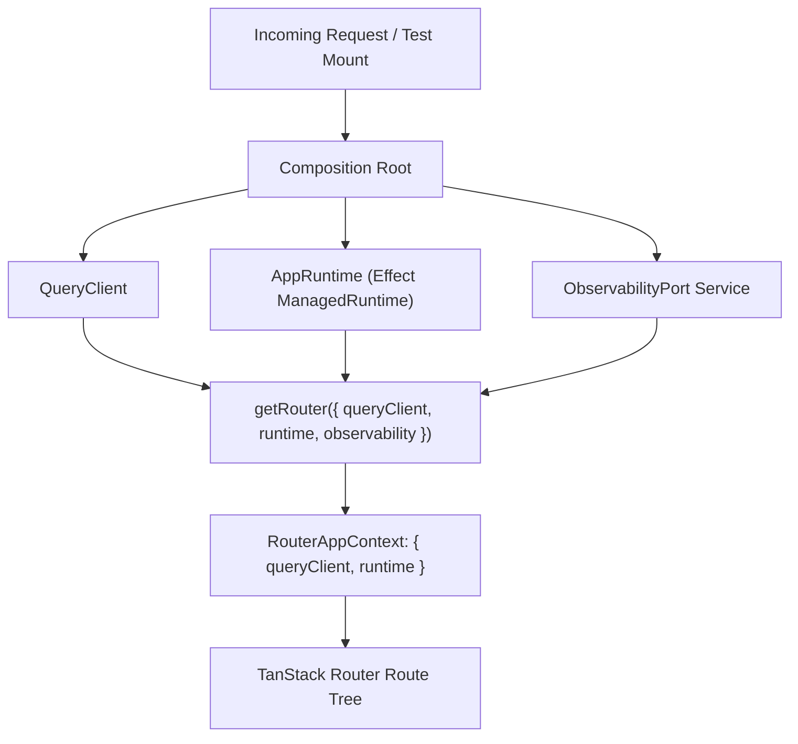
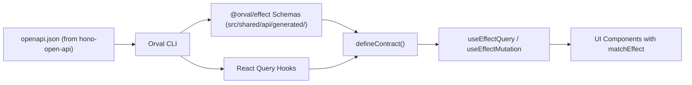
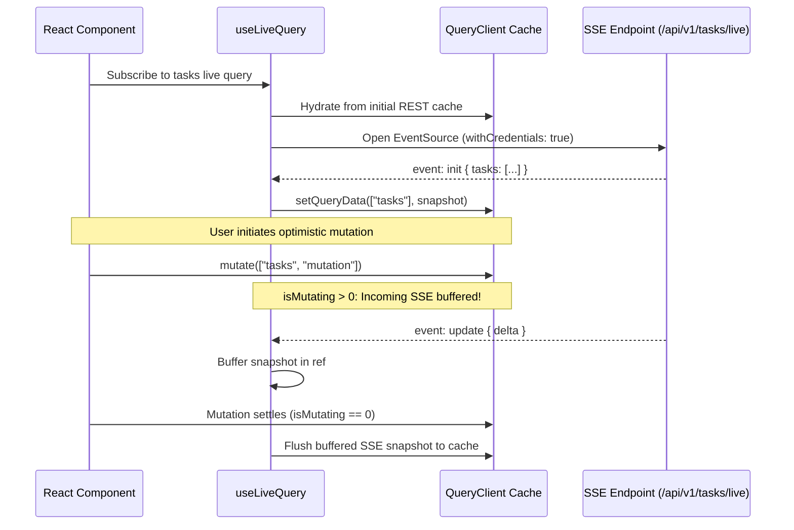
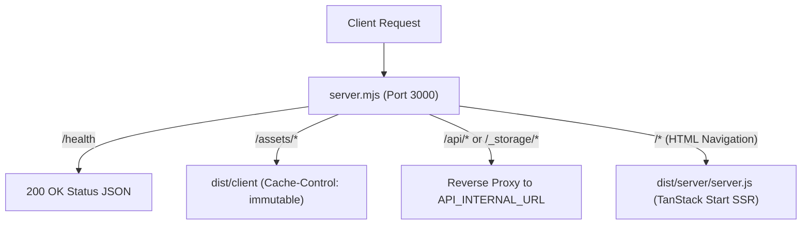

# TanStack OpenAPI Starter — Architecture Guide

This document specifies the technical architecture, runtime composition, data flow, design system, and error handling of `tanstack-open-api`. It serves as the primary system reference and aligns directly with the repository's Architecture Decision Records (`ADR-0001` through `ADR-0009`).

---

## 1. System Overview & ADR Index

`tanstack-open-api` is a full-stack React 19 frontend starter kit designed to pair directly with [`hono-open-api`](https://github.com/Guiguerreiro39/hono-open-api). It is engineered for type-safety across the wire, per-request SSR isolation, schema-validated forms, real-time synchronization, and zero-leak telemetry.

### Architecture Decision Records (ADRs)

| ADR            | Title                                                  | Core Decision & Impact                                                                                                                         |
| :------------- | :----------------------------------------------------- | :--------------------------------------------------------------------------------------------------------------------------------------------- |
| **`ADR-0001`** | Feature-Sliced Architecture and App Composition        | Enforces 4 FSD layers (`app`, `routes`, `features`, `shared`) and side-effect-free `Composition Root` (`getRouter`, `createAppRuntime`).       |
| **`ADR-0002`** | Env, Orval/Effect Contracts, and Error Taxonomy        | Dual-target Orval generation, `defineContract`, 11 status `Data.TaggedError` classes, and runtime schema decoding.                             |
| **`ADR-0003`** | Better Auth Session Guards and RBAC                    | Isomorphic SSR header forwarding via `authSessionQueryOptions`, pathless `_app.tsx` route guards, and `<Can />` authorization.                 |
| **`ADR-0004`** | Realtime SSE Live Query and Optimistic Mutations       | `useLiveQuery` over `/api/v1/tasks/live`, buffering updates while `["tasks", "mutation"]` mutations are in flight.                             |
| **`ADR-0005`** | Frontend Observability and Trace Correlation           | Driver-agnostic `ObservabilityPort` (Sentry, Datadog, Spy) with W3C `traceparent` and `X-Request-Id` trace correlation.                        |
| **`ADR-0006`** | Single-Source Themeable Design System                  | Semantic OKLCH tokens in `src/styles/theme.css`, Tailwind v4 `@theme inline`, and `shadow-tactile` / `interactive-tactile` elevation.          |
| **`ADR-0007`** | shadcn/ui Catalog, TanStack Form, and Reference Slices | `shadcn/ui` components, TanStack Form with Effect `Schema.standardSchemaV1`, and reference slices (`tasks`, `files`, `showcase`).              |
| **`ADR-0008`** | Testing Strategy and Runtime Verification              | Boundary-only Vitest 4 harness with MSW v2, `MockEventSource`, `MockXMLHttpRequest`, and the `.agents/skills/verify-tanstack-open-api/` skill. |
| **`ADR-0009`** | Biome 2 Guardrails, CI Pipeline, and Container Runtime | Biome 2 lint/format enforcement, 5-stage Dockerfile, Node 24 runtime, and `server.mjs` with reverse proxy.                                     |

---

## 2. Runtime Composition & Per-Request Isolation (ADR-0001)

The application avoids global singleton state in favor of an explicit **Composition Root** executed per request on the server and once on client bootstrap.



### Composition Mechanics

1. **`createAppRuntime` (`src/app/runtime.ts`)**:
   Constructs an Effect `ManagedRuntime` by merging the `ObservabilityPort` layer with optional injected dependencies. It contains zero global side effects and accepts custom telemetry layers for tests or SSR environments.
2. **`getRouter` (`src/router.tsx`)**:
   Assembles the TanStack Router instance. It provisions a fresh `QueryClient` (with `staleTime: 60_000`), wires `RouterAppContext`, registers router lifecycle hooks with `observability.initRouter(router)`, and delegates SSR cache dehydration via `setupRouterSsrQueryIntegration`.
3. **Per-Request SSR Safety**:
   When rendering on the server (e.g. inside Node `server.mjs` or test harness `renderAppRoutes`), each request constructs its own `router`, `queryClient`, and `appRuntime`. Cache entries, credentials, and errors cannot leak across concurrent user requests.

---

## 3. Feature-Sliced Design (FSD) Layer Hierarchy (ADR-0001)

Code is partitioned into four horizontal layers governed by a strict unidirectional Directed Acyclic Graph (DAG):

```text
src/
├── app/          # Layer 4 (Top): Application runtime, providers, shell bootstrap
├── routes/       # Layer 3: File-based routing, URL search validation, layout guards
├── features/     # Layer 2: Self-contained business slices (auth, tasks, files, showcase)
└── shared/       # Layer 1 (Bottom): Reusable UI primitives, contracts, observability, config
```

### Dependency Rules

- **Unidirectional Imports**: Code at layer $N$ may only import from layer $N-1$ and below:
  - `app` $\to$ `routes`, `features`, `shared`
  - `routes` $\to$ `features`, `shared`
  - `features` $\to$ `shared`
  - `shared` $\to$ external libraries only
- **Slice Isolation**: Modules inside `src/features/<slice-a>/` cannot import from `src/features/<slice-b>/`. Cross-slice coordination occurs through URL navigation, route context, or shared contracts.
- **Segment Structure**: Slices are segmented into `api/` (contracts & query options), `model/` (domain logic & schemas), and `ui/` (React components). Barrel files (`index.ts`) are disallowed to prevent circular dependencies. Biome `style/noRestrictedImports` enforces these boundaries automatically.

---

## 4. Schema-Driven API Contracts & Error Taxonomy (ADR-0002)

Data exchange between frontend and backend is governed by OpenAPI contracts and Effect schemas, preventing drift and typing failure modes at runtime.



### Contract Binding (`defineContract`)

All query and mutation endpoints are bound using `defineContract` (`src/shared/api/contracts.ts`) and executed through `useEffectQuery` and `useEffectMutation`. This pairs:

1. The transport operation or URL.
2. The Effect `Schema` for runtime response decoding.
3. An error decoder that translates HTTP statuses into typed `Data.TaggedError` classes.

This boundary guarantees runtime response validation against generated schemas, automatic defect reporting for 5xx failures or `SchemaDecodeError`, and automatic session resets on 401 Unauthorized.

### The 11 Status `Data.TaggedError` Hierarchy

All API error responses map into an explicit error taxonomy:

| Status        | Tagged Error Class         | UI Handling Strategy                                |
| :------------ | :------------------------- | :-------------------------------------------------- |
| **`400`**     | `BadRequestError`          | Display input validation warnings                   |
| **`401`**     | `UnauthorizedError`        | Clear session query cache and redirect to `/login`  |
| **`402`**     | `PaymentRequiredError`     | Render upgrade or billing modal                     |
| **`403`**     | `ForbiddenError`           | Render contextual permission denial in-place        |
| **`404`**     | `NotFoundError`            | Show resource-not-found placeholder                 |
| **`409`**     | `ConflictError`            | Prompt user to resolve version conflict             |
| **`422`**     | `UnprocessableEntityError` | Map field errors to TanStack Form fields            |
| **`429`**     | `TooManyRequestsError`     | Display rate-limit retry notification               |
| **`500`**     | `InternalServerError`      | Capture as **Defect** and render fallback           |
| **`502`**     | `BadGatewayError`          | Capture as **Defect** and alert offline proxy       |
| **`503`**     | `ServiceUnavailableError`  | Capture as **Defect** and show maintenance banner   |
| **Transport** | `UnknownError`             | Network timeout or fetch crash                      |
| **Schema**    | `SchemaDecodeError`        | Contract drift detection (response violates schema) |

Errors are consumed cleanly in React components using `matchEffect` with `onTag` discriminant error matching:

```tsx
matchEffect(result, {
  onPending: () => <LoadingSkeleton />,
  onSuccess: (data) => <TaskListView tasks={data} />,
  onFailure: (error) => <GenericErrorAlert error={error} />,
  onTag: {
    ForbiddenError: (err) => <AccessDeniedMessage error={err} />,
  },
});
```

---

## 5. Authentication, SSR Guards & RBAC (ADR-0003)

### Isomorphic SSR Header Forwarding

Authentication relies on Better Auth (`authClient`). During server-side rendering, session cookies or bearer tokens must be forwarded from the incoming browser request to the upstream API.

- `authSessionQueryOptions` (`src/features/auth/api/session.ts`) wraps the session lookup in TanStack Start's `createIsomorphicFn`.
- On the server, it extracts the `cookie` and `authorization` headers from the SSR request and passes them to the internal API call.
- On the client, credentials are managed automatically via `credentials: "include"`.

### Pathless Route Guards (`src/routes/_app.tsx`)

Protected routes live under the pathless `_app.tsx` layout route:

```tsx
export const Route = createFileRoute("/_app")({
  beforeLoad: async ({ context, location }) => {
    const sessionData = await context.queryClient.ensureQueryData(authSessionQueryOptions);
    if (!sessionData?.user) {
      throw redirect({
        to: "/login",
        search: { redirect: location.href },
      });
    }
    return { user: sessionData.user, session: sessionData.session };
  },
  component: AppLayout,
});
```

### Role-Based Access Control (RBAC) & `<Can />`

Permissions follow `src/shared/lib/rbac.ts` with roles (`admin`, `member`, `guest`) and resource actions (`tasks:read`, `tasks:write`, `tasks:delete`, `files:upload`, etc.):

- **Resource Scopes**: Distinguishes between `own` (user owns the resource) vs `all` (user has global administrative rights).
- **Declarative Guard `<Can />` (`src/shared/ui/can.tsx`)**:

  ```tsx
  <Can I="delete" a="task" this={task}>
    <DeleteTaskButton onClick={() => deleteTask(task.id)} />
  </Can>
  ```

---

## 6. Realtime SSE Live Query & Mutation Buffering (ADR-0004)

Real-time synchronisation is powered by Server-Sent Events (SSE) via the `useLiveQuery` hook (`src/shared/lib/hooks/use-live-query.ts`).



### Mutation Buffering Mechanics

When a user mutates data locally (e.g., toggling a task checkbox), an optimistic update is applied to `["tasks"]` and the mutation is keyed under `["tasks", "mutation"]`. If an incoming SSE message arrives while `queryClient.isMutating({ mutationKey: ["tasks", "mutation"] }) > 0`, the live snapshot is buffered in memory. Only after the mutation finishes (success or rollback) is the buffered snapshot applied to the cache, preventing race-condition jitter.

### Typed Error Channel & Non-Blocking Stream Degradation

`useLiveQuery` inherits a typed error channel inferred from the contract descriptor (`OperationErrorStatuses<Op>`). Its `.toEffect()` method implements non-blocking stream degradation:

- When cached data exists (`queryResult.data !== undefined`), `.toEffect()` succeeds with the cached data (`Effect.succeed(queryResult.data)`), ensuring transient SSE drops or reconnect cycles do not tear down the UI.
- When no cached data exists and a stream error occurs (`streamError !== null`), `.toEffect()` fails with `streamError` (`Effect.fail(streamError)`).

---

## 7. Frontend Observability & Trace Correlation (ADR-0005)

Telemetry is decoupled through `ObservabilityPort` (`src/shared/observability/port.ts`), allowing zero-vendor lock-in.

### Pluggable Adapters

1. **`SentryObservabilityAdapter`**: Captures unhandled exceptions, React 19 render/hydration crashes, and session replays.
2. **`DatadogObservabilityAdapter`**: Ingests RUM user actions, resource timings, and browser error logs.
3. **`SpyObservabilityAdapter`**: Zero-dependency in-memory spy used in unit and boundary tests (`src/test/spy-observability.ts`).
4. **`CompositeObservabilityAdapter`**: Fans out events across multiple active adapters simultaneously.

### Defect vs. Breadcrumb Discipline

- **Defects (`captureDefect`, `captureReactError`)**: Triggered exclusively by unhandled failures (`5xx`, `UnknownError`, `SchemaDecodeError`, or uncaught React errors). These represent actionable operational defects.
- **Breadcrumbs (`recordBreadcrumb`)**: Expected client events (`4xx` domain errors like `404 Not Found` or `422 Validation Error`, UI clicks, and route transitions) are recorded strictly as PII-safe breadcrumbs for diagnostic context.

### Outbound Trace Correlation (`customFetch`)

`customFetch` (`src/shared/api/fetch.ts`) automatically generates and forwards:

- **`X-Request-Id`**: A unique UUID per outgoing request for cross-tier log search.
- **W3C `traceparent`**: Distributed trace context (`00-<trace_id>-<span_id>-01`) correlating frontend network calls with backend spans in `hono-open-api`.

---

## 8. Single-Source Design Tokens & Tactile Elevation (ADR-0006 & ADR-0007)

Visual styles are anchored in `src/styles/theme.css` using standard OKLCH color spaces and bound to Tailwind CSS v4 via `@theme inline`.

### Theme Presets

Themes are toggled via `[data-theme="<preset>"]` attributes on the root document:

- **`warm-tactile` (Default)**: Terracotta (`oklch(0.491 0.17 34.3)`), sage green, soft warm backgrounds, and tactile offset shadows.
- **`editorial-slate`**: High-restraint monochrome slate with diffuse shadows and minimalist typography.
- **`neo-brutalist`**: Punchy, high-contrast borders and sharp retro offset shadows.

### Tactile Elevation Utilities

- **`shadow-tactile`**: Renders sharp physical box shadows (`box-shadow: var(--shadow-tactile)`).
- **`interactive-tactile`**: Adds interactive physics:
  - Hover: translates $-2\text{px}$ on the Y-axis and enlarges the offset shadow.
  - Active: translates $+2\text{px}$ on both axes, collapsing the shadow into the surface.

---

## 9. Form Primitives & File Transfer Pipelines (ADR-0007)

### Forms with StandardSchemaV1

Forms use `@tanstack/react-form` combined with Effect `Schema.standardSchemaV1` via `useAppForm` (`src/shared/ui/form.tsx`). Context-aware field primitives (`AppForm.Field`, `AppForm.Input`, `AppForm.Checkbox`, `AppForm.Message`) automatically inject `aria-invalid` and link `aria-describedby` error descriptions upon blur or submit.

### Dual File Transfer Pipelines

The file management slice (`src/features/files`) implements two distinct transfer strategies:

1. **Direct Multipart Upload**: Sent directly as `multipart/form-data` to `/api/v1/files/upload`.
2. **Three-Step Presigned Upload**:
   - `POST /api/v1/files/presign`: Backend reserves a `"pending"` record and issues a signed storage URL.
   - `PUT <storage_url>`: Direct binary stream using `MockXMLHttpRequest` / XHR with determinate byte-level progress reporting.
   - `POST /api/v1/files/{id}/complete`: Backend validates payload size and promoted record status to `"ready"`.

---

## 10. Container & Production Runtime (ADR-0009)

The production container packages the application with Node 24 (`node:24-slim`) and runs a lightweight zero-dependency server:



`server.mjs` handles static asset serving, reverse-proxy streaming to `API_INTERNAL_URL` (preserving cookies, auth headers, and SSE chunking with `X-Accel-Buffering: no`), and delegates all document requests to TanStack Start's SSR handler.
