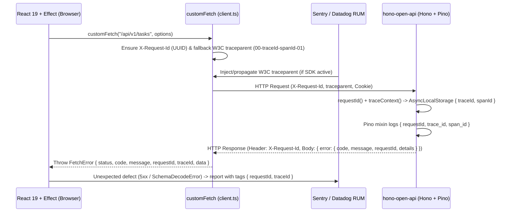

# Frontend Observability Research: Sentry, Datadog RUM/Logs, and W3C `traceparent` Correlation

> **Wayfinder Research Ticket**: [#5](https://github.com/Guiguerreiro39/tanstack-open-api/issues/5) — Part of [#1](https://github.com/Guiguerreiro39/tanstack-open-api/issues/1)

## Executive Summary & Decision Gist

1. **SDK Selection**:
   - **Sentry**: Use `@sentry/tanstackstart-react` (or `@sentry/react` for pure client SPA bundles) with `@sentry/vite-plugin` (`sentryTanstackStart` / `sentryVitePlugin`), `Sentry.tanstackRouterBrowserTracingIntegration(router)` for route transactions, `Sentry.replayIntegration({ maskAllText: true, blockAllMedia: true })` for privacy-safe session replay, and `Sentry.reactErrorHandler()` wired into React 19's `createRoot` / `hydrateRoot` hooks (`onUncaughtError`, `onCaughtError`, `onRecoverableError`).
   - **Datadog**: Use `@datadog/browser-rum`, `@datadog/browser-rum-react` (`instrumentTanstackRouter(router)` from `@datadog/browser-rum-react/tanstack-router` and `addReactError`), and `@datadog/browser-logs` (`forwardErrorsToLogs: true`) with shared `clientToken`, `site`, `service`, `env`, and `version` for automatic RUM-to-Logs session/view correlation (`session_id`, `view.id`).
2. **End-to-End W3C `traceparent` + `X-Request-Id` Correlation with `hono-open-api`**:
   - Configure Datadog RUM `allowedTracingUrls: [{ match: apiOriginMatcher, propagatorTypes: ["tracecontext"] }]` and Sentry `tracePropagationTargets` + `propagateTraceparent: true` (when Datadog RUM is not already injecting `traceparent`).
   - Enhance `customFetch` (`src/shared/api/client.ts`) to attach an outbound `X-Request-Id` (`crypto.randomUUID()`) and fallback W3C `traceparent` (`00-<32-hex-traceId>-<16-hex-spanId>-01`), parse `hono-open-api`'s canonical `{ error: { code, message, requestId, details } }` envelope (`hono-open-api/src/core/errors.ts#L156-L163`) and `X-Request-Id` response header, and surface `requestId`, `traceId`, and `code` on `FetchError` and Effect tagged errors.
3. **Zero-Account Local/Test Fallback via `ObservabilityPort` (`Effect.Tag` + `Layer`)**:
   - Gate SDK initialization on `VITE_SENTRY_DSN` and `VITE_DD_APPLICATION_ID` + `VITE_DD_CLIENT_TOKEN`.
   - Provide a unified `ObservabilityPort` (`SentryAdapter`, `DatadogAdapter`, `CompositeAdapter`, `ConsoleAdapter`, `NoopAdapter`) so local development and Vitest run with zero external accounts or network calls.
   - Only report **unexpected defects** (`SchemaDecodeError`, `UnknownError`, 5xx `FetchError`, and uncaught React render errors) as error alerts (`captureException` / `addError`), while recording **expected domain failures** (`UnauthorizedError` 401, `NotFoundError` 404, `ConflictError` 409, `ValidationError` 422) solely as breadcrumbs/debug telemetry.

---

## 1. Sentry SDK Selection & Setup (`@sentry/tanstackstart-react` / `@sentry/react`)

### 1.1 `@sentry/tanstackstart-react` vs `@sentry/react` + `@sentry/vite-plugin`

| Capability | `@sentry/react` + `@sentry/vite-plugin` | `@sentry/tanstackstart-react` |
| :--- | :--- | :--- |
| **Target Architecture** | Client-side SPA / CSR or custom SSR entry points where backend is a separate service (`hono-open-api`). | Full-stack TanStack Start apps using SSR middleware and `createServerFn` RPCs in addition to browser routing. |
| **Browser API Surface** | Provides `init`, `tanstackRouterBrowserTracingIntegration`, `replayIntegration`, `reactErrorHandler`, `setUser`, `captureException`, `addBreadcrumb`. | Re-exports the complete `@sentry/react` browser surface on the client and `@sentry/node` on the server ([Sentry TanStack Start Docs](https://docs.sentry.io/platforms/javascript/guides/tanstackstart-react/)). |
| **Vite Source Map Plugin** | `sentryVitePlugin` from `@sentry/vite-plugin` ([Sentry Vite Plugin Docs](https://docs.sentry.io/platforms/javascript/guides/react/sourcemaps/uploading/vite/)). | `sentryTanstackStart` from `@sentry/tanstackstart-react/vite` (wraps `@sentry/vite-plugin` and adds optional `tunnelRoute` + server function wrapping). |
| **Starter-Kit Recommendation** | Because `tanstack-open-api` uses `@tanstack/react-start` (`package.json#L27`), use `@sentry/tanstackstart-react` if server functions/SSR middleware are enabled, or `@sentry/react` + `@sentry/vite-plugin` if keeping telemetry strictly browser-scoped behind `ObservabilityPort`. Both expose identical client APIs (`tanstackRouterBrowserTracingIntegration`, `replayIntegration`, `reactErrorHandler`). |

### 1.2 TanStack Router Tracing & Session Replay Initialization

Sentry's `tanstackRouterBrowserTracingIntegration(router)` (compatible with `@tanstack/react-router` v1.64.0+; `forklore-fe` uses `^1.141.1`) hooks into the router instance created in `src/router.tsx` to emit parameterized `pageload` and `navigation` spans (e.g., `/recipes/$recipeId` instead of raw URLs) ([Sentry TanStack Router Integration Docs](https://docs.sentry.io/platforms/javascript/guides/react/features/tanstack-router/)).

```ts
// src/shared/lib/observability/sentry-client.ts
import * as Sentry from "@sentry/react"; // or "@sentry/tanstackstart-react"
import type { AnyRouter } from "@tanstack/react-router";

export function initSentryClient(router: AnyRouter, apiOrigins: Array<string | RegExp>) {
  const dsn = import.meta.env.VITE_SENTRY_DSN;
  if (!dsn || typeof window === "undefined") {
    return false;
  }

  // Only let Sentry inject W3C `traceparent` if Datadog RUM is not already injecting it,
  // avoiding duplicate/overwritten `traceparent` headers on outgoing fetch calls.
  const isDatadogRumActive = Boolean(
    import.meta.env.VITE_DD_APPLICATION_ID && import.meta.env.VITE_DD_CLIENT_TOKEN,
  );

  Sentry.init({
    dsn,
    environment: import.meta.env.MODE,
    release: import.meta.env.VITE_APP_VERSION,
    integrations: [
      Sentry.tanstackRouterBrowserTracingIntegration(router),
      Sentry.replayIntegration({
        maskAllText: true,
        maskAllInputs: true,
        blockAllMedia: true,
      }),
    ],
    // Performance tracing
    tracesSampleRate: Number(import.meta.env.VITE_SENTRY_TRACES_SAMPLE_RATE ?? 0.2),
    tracePropagationTargets: ["localhost", /^\//, ...apiOrigins],
    propagateTraceparent: !isDatadogRumActive,

    // Session Replay (10% baseline, 100% on error)
    replaysSessionSampleRate: Number(import.meta.env.VITE_SENTRY_REPLAY_SAMPLE_RATE ?? 0.1),
    replaysOnErrorSampleRate: 1.0,
  });

  return true;
}
```

**Primary Sources**:
- [Sentry React — TanStack Router Integration](https://docs.sentry.io/platforms/javascript/guides/react/features/tanstack-router/)
- [Sentry JavaScript — `tracePropagationTargets` & `propagateTraceparent`](https://docs.sentry.io/platforms/javascript/guides/react/configuration/options/#propagateTraceparent) (`propagateTraceparent: true` available since SDK v8.22.0+ to emit W3C `traceparent` alongside `sentry-trace` and `baggage`).
- [Sentry Session Replay — Privacy Configuration](https://docs.sentry.io/platforms/javascript/session-replay/privacy/)

### 1.3 React 19 Root Error Hooks (`onUncaughtError`, `onCaughtError`, `onRecoverableError`)

React 19 (`react@19.2.3` in `forklore-fe/package.json#L36-L37`) introduced three root-level error callbacks on `createRoot` and `hydrateRoot`. `@sentry/react` provides `Sentry.reactErrorHandler()` to capture errors with full React `errorInfo.componentStack` metadata ([Sentry React 19 Error Handler Docs](https://docs.sentry.io/platforms/javascript/guides/react/features/error-boundary/#react-19-error-hooks)):

- `onUncaughtError`: Invoked when an error is thrown during rendering, lifecycle methods, or constructors and is **not** caught by any `<ErrorBoundary>`.
- `onCaughtError`: Invoked when React catches an error inside an `<ErrorBoundary>`.
- `onRecoverableError`: Invoked when React automatically recovers from an error (such as SSR hydration mismatches).

```tsx
// Client hydration / root entry (e.g., src/client.tsx)
import { hydrateRoot } from "react-dom/client";
import { StartClient } from "@tanstack/react-start";
import { createRootErrorHandlers } from "@/shared/lib/observability/react-error-hooks";

const rootErrorHandlers = createRootErrorHandlers(observability);

hydrateRoot(document, <StartClient router={router} />, {
  onUncaughtError: rootErrorHandlers.onUncaughtError,
  onCaughtError: rootErrorHandlers.onCaughtError,
  onRecoverableError: rootErrorHandlers.onRecoverableError,
});
```

When Sentry is active, `Sentry.reactErrorHandler((error, errorInfo) => ...)` formats and forwards `errorInfo.componentStack` directly into the Sentry issue event.

### 1.4 Source Maps Upload (`@sentry/vite-plugin` & GitHub Actions)

To symbolicate production stack traces without exposing raw `.map` files publicly on the CDN/server, configure `build.sourcemap: "hidden"` and `filesToDeleteAfterUpload` in `vite.config.ts` ([Sentry Vite Plugin Options](https://docs.sentry.io/platforms/javascript/guides/react/sourcemaps/uploading/vite/)):

```ts
// vite.config.ts
import { sentryVitePlugin } from "@sentry/vite-plugin";
import { defineConfig } from "vite";

export default defineConfig({
  build: {
    sourcemap: "hidden",
  },
  plugins: [
    // ...tsconfigPaths(), tailwindcss(), tanstackStart(), viteReact()
    ...(process.env.SENTRY_AUTH_TOKEN
      ? [
          sentryVitePlugin({
            org: process.env.SENTRY_ORG,
            project: process.env.SENTRY_PROJECT,
            authToken: process.env.SENTRY_AUTH_TOKEN,
            release: {
              name: process.env.VITE_APP_VERSION,
            },
            sourcemaps: {
              filesToDeleteAfterUpload: ["./dist/**/*.map", "./.output/**/*.map"],
            },
          }),
        ]
      : []),
  ],
});
```

In `.github/workflows/deploy.yml`, pass `SENTRY_AUTH_TOKEN`, `SENTRY_ORG`, `SENTRY_PROJECT`, and `VITE_APP_VERSION: ${{ github.sha }}` to `pnpm build`. Because the plugin is conditionally registered on `process.env.SENTRY_AUTH_TOKEN`, local builds and forks without secrets succeed with zero warnings or network calls.

---

## 2. Datadog Browser SDK Setup (`@datadog/browser-rum`, `@datadog/browser-rum-react`, `@datadog/browser-logs`)

### 2.1 Coordinated RUM + Logs Initialization & Privacy Defaults

When `@datadog/browser-rum` and `@datadog/browser-logs` are initialized with matching `clientToken`, `site`, `service`, `env`, and `version`, Datadog automatically injects `application_id`, `session_id`, and `view.id` into every browser log so operators can pivot directly between a RUM session replay, backend APM trace, and frontend structured logs ([Datadog Connect RUM and Logs](https://docs.datadoghq.com/real_user_monitoring/guide/connect-rum-and-logs/), [Datadog Browser Log Collection](https://docs.datadoghq.com/logs/log_collection/javascript/)).

```ts
// src/shared/lib/observability/datadog-client.ts
import { datadogLogs } from "@datadog/browser-logs";
import { datadogRum } from "@datadog/browser-rum";
import { instrumentTanstackRouter } from "@datadog/browser-rum-react/tanstack-router";
import type { AnyRouter } from "@tanstack/react-router";

export function initDatadogClient(router: AnyRouter, apiOrigins: Array<string | RegExp>) {
  const applicationId = import.meta.env.VITE_DD_APPLICATION_ID;
  const clientToken = import.meta.env.VITE_DD_CLIENT_TOKEN;
  if (!applicationId || !clientToken || typeof window === "undefined") {
    return false;
  }

  const sharedConfig = {
    clientToken,
    site: (import.meta.env.VITE_DD_SITE as string | undefined) ?? "datadoghq.com",
    service: (import.meta.env.VITE_DD_SERVICE as string | undefined) ?? "tanstack-open-api-web",
    env: import.meta.env.MODE,
    version: (import.meta.env.VITE_APP_VERSION as string | undefined) ?? "0.0.0",
  };

  datadogRum.init({
    ...sharedConfig,
    applicationId,
    sessionSampleRate: Number(import.meta.env.VITE_DD_SESSION_SAMPLE_RATE ?? 100),
    sessionReplaySampleRate: Number(import.meta.env.VITE_DD_REPLAY_SAMPLE_RATE ?? 20),
    trackUserInteractions: true,
    trackResources: true,
    trackLongTasks: true,
    defaultPrivacyLevel: "mask-user-input",
    // Propagate W3C `traceparent` (`00-<traceId>-<spanId>-<flags>`) to hono-open-api
    allowedTracingUrls: apiOrigins.map((match) => ({
      match,
      propagatorTypes: ["tracecontext"],
    })),
    traceSampleRate: Number(import.meta.env.VITE_DD_TRACE_SAMPLE_RATE ?? 100),
  });

  // Subscribe to TanStack Router `onResolved` lifecycle to record parameterized views
  // (e.g., `/recipes/$id`) without replacing `@tanstack/react-router`'s `createRouter`.
  instrumentTanstackRouter(router);

  datadogLogs.init({
    ...sharedConfig,
    sessionSampleRate: 100,
    forwardErrorsToLogs: true,
    forwardConsoleLogs: ["error"],
  });

  return true;
}
```

### 2.2 TanStack Router & React 19 Error Integration in Datadog

1. **Router View Tracking (`instrumentTanstackRouter`)**:
   - `@datadog/browser-rum-react/tanstack-router` exports both a wrapped `createRouter` and a standalone `instrumentTanstackRouter(router)` helper ([Datadog TanStack Router Integration](https://docs.datadoghq.com/real_user_monitoring/application_monitoring/browser/advanced_configuration/?tab=tanstackrouter#integrated-routers), [`browser-sdk` source](https://github.com/DataDog/browser-sdk/tree/main/packages/rum-react/src/domain/tanstackRouter)).
   - `instrumentTanstackRouter(router)` subscribes to `router.subscribe("onResolved", ...)` and extracts the leaf route match's parameterized `fullPath` (e.g. `/recipes/$recipeId`), calling `datadogRum.startView({ name: viewPath })` whenever `event.pathChanged` is `true`.
   - Using `instrumentTanstackRouter(router)` (or an equivalent `router.subscribe("onResolved", ...)` hook inside `ObservabilityPort`) preserves the standard `createTanStackRouter` import in `src/router.tsx#L2` and allows Sentry and Datadog to instrument the exact same `router` instance simultaneously.
2. **React 19 Error Hooks (`addReactError`)**:
   - `@datadog/browser-rum-react` exports `addReactError(error, errorInfo)` ([Datadog Collecting Browser Errors](https://docs.datadoghq.com/real_user_monitoring/application_monitoring/browser/collecting_browser_errors/#react-error-boundary)).
   - Wire `addReactError(error, errorInfo)` into `createRoot` / `hydrateRoot`'s `onUncaughtError` and `onCaughtError` callbacks (and avoid also wrapping the same tree in Datadog's `<ErrorBoundary>` so caught errors are not reported twice).

### 2.3 User Session Sync with Better Auth (`setUser` / `clearUser`)

`forklore-fe/src/shared/lib/auth-client.ts` exposes `useSession()` from `better-auth/react`. Whenever `session?.user` transitions between authenticated and unauthenticated states:

- **Sentry**: `Sentry.setUser({ id: user.id, email: user.email, username: user.name })` on login; `Sentry.setUser(null)` on logout ([Sentry Identifying Users](https://docs.sentry.io/platforms/javascript/guides/react/enriching-events/identify-user/)).
- **Datadog RUM + Logs**: Call **both** `datadogRum.setUser({ id: user.id, email: user.email, name: user.name })` and `datadogLogs.setUser({ id: user.id, email: user.email, name: user.name })` on login, and `datadogRum.clearUser()` + `datadogLogs.clearUser()` on logout ([Datadog RUM User Session](https://docs.datadoghq.com/real_user_monitoring/application_monitoring/browser/advanced_configuration/#override-default-rum-view-names), [Datadog Logs User Context](https://docs.datadoghq.com/logs/log_collection/javascript/#add-user-context)).

---

## 3. W3C `traceparent` & `X-Request-Id` Correlation with `hono-open-api`

### 3.1 How `hono-open-api` Consumes `traceparent` and `X-Request-Id`

Inspecting `hono-open-api` reveals a strict, standards-based observability contract:

1. **Request ID (`X-Request-Id`)**:
   - `hono-open-api/src/app.ts#L97` mounts `requestId()` (`hono/request-id`) on `*`.
   - If the client sends an `X-Request-Id` request header, Hono adopts it as `c.get("requestId")` and echoes `X-Request-Id` in the HTTP response headers (`hono-open-api/src/core/observability/trace.test.ts#L65-L71`). Otherwise, Hono generates a fresh UUID.
   - Every error response (`4xx` and `5xx`) in `hono-open-api/src/core/errors.ts#L156-L163` returns:
     ```json
     {
       "error": {
         "code": "VALIDATION_ERROR",
         "message": "Validation failed",
         "requestId": "req-422",
         "details": [...]
       }
     }
     ```
2. **W3C Trace Context (`traceparent`)**:
   - `hono-open-api/src/core/observability/trace.ts#L5-L97` validates inbound `traceparent` headers against `/^([0-9a-f]{2})-([0-9a-f]{32})-([0-9a-f]{16})-([0-9a-f]{2})$/` (rejecting version `ff`, all-zero 32-hex `traceId`, or all-zero 16-hex `parentSpanId`).
   - When valid, `createTraceContext()` preserves the browser's 32-hex `traceId`, records the browser span as `parentSpanId`, and mints a fresh 16-hex server `spanId` inside `AsyncLocalStorage<TraceContext>`.
   - `hono-open-api/src/core/logger.ts#L46-L55` defines a Pino `mixin()` that automatically injects `trace_id: trace.traceId` and `span_id: trace.spanId` (plus `requestId` via `hono-pino` at `src/core/logger.ts#L73`) into every backend log entry.
   - By design (`trace.test.ts#L72`), `hono-open-api` does **not** emit a `traceparent` response header; `X-Request-Id` and the shared `trace_id` are the correlation keys.

### 3.2 End-to-End Trace & Request ID Flow



### 3.3 Required CORS Alignment for Cross-Origin Deployments

In local dev (`forklore-fe/vite.config.ts#L11-L36`), Vite proxies `/api`, `/tasks`, `/auth`, etc. same-origin, so custom headers require no CORS preflight. When `VITE_API_URL` points to a cross-origin `hono-open-api` deployment (`hono-open-api/src/app.ts#L101`):

- **Allowed Request Headers**: `X-Request-Id`, `traceparent`, `tracestate`, `sentry-trace`, `baggage` (Hono's default `cors()` reflects `Access-Control-Request-Headers` automatically when `allowHeaders` is omitted; if `allowHeaders` is explicitly configured in `hono-open-api`, include these 5 headers).
- **Exposed Response Headers**: Add `exposeHeaders: ["X-Request-Id"]` to `cors({ origin: deps.env.CORS_ORIGINS, credentials: true, exposeHeaders: ["X-Request-Id"] })` in `hono-open-api/src/app.ts#L101` so browser `fetch` can read `response.headers.get("X-Request-Id")` on `2xx` responses and non-JSON gateway errors (while `4xx`/`5xx` JSON responses already include `error.requestId` in the response body).

### 3.4 Upgrading `customFetch` & `FetchError` (`src/shared/api/client.ts`)

Currently, `forklore-fe/src/shared/api/client.ts` only inspects `errorData?.message` and `errorData?.error?.issues` (an older Zod error shape) and does not extract `errorData?.error?.requestId`, `errorData?.error?.code`, or `errorData?.error?.details` from `hono-open-api`'s `ErrorResponseSchema`.

Upgrading `src/shared/api/client.ts` ensures every request has both `X-Request-Id` and W3C `traceparent` (even when Sentry/Datadog are disabled in local dev or tests) and preserves `requestId` + `traceId` on `FetchError`:

```ts
// src/shared/api/client.ts
export interface HonoErrorEnvelope {
  error?: {
    code?: string;
    message?: string;
    requestId?: string;
    details?: unknown;
    // Legacy compatibility with raw @hono/zod-openapi defaultHook if uncustomized
    issues?: Array<{
      code?: string;
      path?: Array<string | number>;
      message?: string;
    }>;
  };
  message?: string;
}

export class FetchError extends Error {
  readonly status: number;
  readonly code?: string;
  readonly requestId?: string;
  readonly traceId?: string;
  readonly data?: HonoErrorEnvelope;

  constructor(options: {
    status: number;
    message: string;
    code?: string;
    requestId?: string;
    traceId?: string;
    data?: HonoErrorEnvelope;
  }) {
    super(options.message);
    this.name = "FetchError";
    this.status = options.status;
    this.code = options.code;
    this.requestId = options.requestId;
    this.traceId = options.traceId;
    this.data = options.data;
  }
}

function randomHex(bytes: number): string {
  const buf = new Uint8Array(bytes);
  crypto.getRandomValues(buf);
  let hex = "";
  for (const b of buf) {
    hex += b.toString(16).padStart(2, "0");
  }
  return hex === "0".repeat(bytes * 2) ? randomHex(bytes) : hex;
}

export function createW3CTraceparent(): { traceparent: string; traceId: string; spanId: string } {
  const traceId = randomHex(16);
  const spanId = randomHex(8);
  return {
    traceId,
    spanId,
    traceparent: `00-${traceId}-${spanId}-01`,
  };
}

export async function customFetch<T>(url: string, options: RequestInit = {}): Promise<T> {
  const envBaseUrl =
    import.meta.env.VITE_API_URL ||
    (typeof process !== "undefined" ? process.env?.VITE_API_URL : undefined);
  const baseURL = envBaseUrl || (typeof window !== "undefined" ? "" : "http://localhost:9999");
  const fullUrl = url.startsWith("http")
    ? url
    : `${baseURL.replace(/\/$/, "")}${url.startsWith("/") ? url : `/${url}`}`;

  const headers = new Headers(options.headers);
  if (!headers.has("Content-Type")) {
    headers.set("Content-Type", "application/json");
  }

  const outboundRequestId = headers.get("X-Request-Id") ?? crypto.randomUUID();
  headers.set("X-Request-Id", outboundRequestId);

  // If neither Datadog nor Sentry injected a traceparent, mint a valid W3C traceparent
  // so hono-open-api's traceContext() middleware always receives a correlated trace_id.
  let traceId: string | undefined;
  const existingTraceparent = headers.get("traceparent");
  if (existingTraceparent) {
    traceId = existingTraceparent.split("-")[1];
  } else {
    const generated = createW3CTraceparent();
    headers.set("traceparent", generated.traceparent);
    traceId = generated.traceId;
  }

  const response = await fetch(fullUrl, {
    ...options,
    headers,
    credentials: "include",
  });

  if (!response.ok) {
    let errorData: HonoErrorEnvelope | undefined;
    try {
      errorData = (await response.json()) as HonoErrorEnvelope;
    } catch {
      errorData = { message: response.statusText };
    }

    const requestId =
      errorData?.error?.requestId ??
      response.headers.get("X-Request-Id") ??
      outboundRequestId;
    const code = errorData?.error?.code;
    const message =
      errorData?.error?.message ||
      errorData?.message ||
      `HTTP error ${response.status}`;

    throw new FetchError({
      status: response.status,
      code,
      message,
      requestId,
      traceId,
      data: errorData,
    });
  }

  if (response.status === 204) {
    return undefined as unknown as T;
  }

  return response.json();
}
```

---

## 4. Unified `ObservabilityPort` Seam & Effect Error Classification

### 4.1 Expected Domain Errors vs Unexpected Defects

In `forklore-fe/src/shared/api/contracts.ts`, errors are modeled using Effect's `Data.TaggedError`:

| Error Class / Condition | HTTP Status | Classification | Telemetry Action in `ObservabilityPort` |
| :--- | :--- | :--- | :--- |
| `UnauthorizedError` | `401` | **Expected Domain Error** | Record breadcrumb only (`category: "api.expected_error"`). Do **not** alert Sentry/Datadog Error Tracking. |
| `NotFoundError` | `404` | **Expected Domain Error** | Record breadcrumb only. |
| `ConflictError` | `409` | **Expected Domain Error** | Record breadcrumb only. |
| `ValidationError` | `422` | **Expected Domain Error** | Record breadcrumb only (attach field paths without sensitive input values). |
| `UnknownError` / `FetchError` (`status >= 500` or network failure) | `5xx` / `0` | **Unexpected Defect** | **Report Exception** (`Sentry.captureException` + `datadogRum.addError` + `datadogLogs.logger.error`) with `{ requestId, traceId, status, path }`. |
| `SchemaDecodeError` (`use-effect-query.ts` / `use-effect-mutation.ts`) | `200` (Contract Drift) | **Unexpected Defect** | **Report Exception** immediately — backend response violated the expected OpenAPI/Effect schema for `descriptor.path`. |
| UnDeclared Error (`Effect.die` in `useEffectQuery`) | `4xx`/`5xx` | **Unexpected Defect** | **Report Exception** — endpoint returned an HTTP status not declared in its `FunctionDescriptor`. |
| React 19 `onUncaughtError` / `onCaughtError` | Render phase | **Unexpected Defect** | **Report React Error** with `componentStack` (`Sentry.reactErrorHandler` + `addReactError`). |

Enriching `src/shared/api/contracts.ts` so every tagged error carries optional `requestId?: string` and `traceId?: string` allows UI error boundaries and toast notifications to display a support correlation ID (`Request ID: req-...`) while keeping `ObservabilityPort` metadata strongly typed.

### 4.2 `ObservabilityPort` Interface & Effect `Context.Tag`

```ts
// src/shared/lib/observability/port.ts
import type { AnyRouter } from "@tanstack/react-router";
import { Context, Layer } from "effect";
import type { ErrorInfo } from "react";

export interface TelemetryUser {
  readonly id: string;
  readonly email?: string | null;
  readonly name?: string | null;
}

export interface DefectContext {
  readonly source: "api" | "schema_decode" | "react_boundary" | "unhandled";
  readonly path?: string;
  readonly status?: number;
  readonly code?: string;
  readonly requestId?: string;
  readonly traceId?: string;
  readonly componentStack?: string | null;
  readonly extra?: Record<string, unknown>;
}

export interface BreadcrumbEntry {
  readonly category: string;
  readonly message: string;
  readonly level?: "debug" | "info" | "warning" | "error";
  readonly data?: Record<string, unknown>;
}

export interface ObservabilityService {
  readonly initRouter: (router: AnyRouter) => void;
  readonly setUser: (user: TelemetryUser | null) => void;
  readonly captureDefect: (error: unknown, context: DefectContext) => void;
  readonly recordBreadcrumb: (entry: BreadcrumbEntry) => void;
  readonly captureReactError: (
    kind: "uncaught" | "caught" | "recoverable",
    error: unknown,
    errorInfo: ErrorInfo,
  ) => void;
}

export class ObservabilityPort extends Context.Tag("ObservabilityPort")<
  ObservabilityPort,
  ObservabilityService
>() {}
```

### 4.3 Adapter Implementations (`Sentry`, `Datadog`, `Composite`, `Console`, `Noop`)

1. **`NoopObservabilityAdapter` (Default for Vitest / CI)**:
   - All methods are synchronous no-ops (`() => {}`).
   - Requires zero accounts, zero globals, and makes zero network requests in `vitest run`.
2. **`ConsoleObservabilityAdapter` (Default for Local Development when env vars are unset)**:
   - Logs `[telemetry:defect]` with `{ requestId, traceId, path, cause }` to `console.error` and `[telemetry:breadcrumb]` to `console.debug`.
3. **`SentryObservabilityAdapter` (Enabled when `VITE_SENTRY_DSN` is set)**:
   - `captureDefect`: Calls `Sentry.withScope((scope) => { scope.setTag("request_id", ctx.requestId); scope.setTag("trace_id", ctx.traceId); scope.setTag("defect_source", ctx.source); scope.setExtras(ctx.extra ?? {}); Sentry.captureException(error); })`.
   - `setUser`: Calls `Sentry.setUser(user ? { id: user.id, email: user.email ?? undefined, username: user.name ?? undefined } : null)`.
   - `captureReactError`: Delegates to `Sentry.reactErrorHandler()`.
4. **`DatadogObservabilityAdapter` (Enabled when `VITE_DD_APPLICATION_ID` and `VITE_DD_CLIENT_TOKEN` are set)**:
   - `captureDefect`: Calls `datadogRum.addError(error, ctx)` and `datadogLogs.logger.error(error instanceof Error ? error.message : String(error), ctx, error instanceof Error ? error : undefined)`.
   - `setUser`: Calls `datadogRum.setUser(...)` + `datadogLogs.setUser(...)` (or `clearUser()` when `null`).
   - `captureReactError`: Calls `addReactError(error as Error, errorInfo)` for `"uncaught"` and `"caught"`, and `datadogLogs.logger.warn("React recoverable hydration error", { componentStack: errorInfo.componentStack }, error instanceof Error ? error : undefined)` for `"recoverable"`.
5. **`CompositeObservabilityAdapter`**:
   - Fans out calls to `[sentryAdapter, datadogAdapter]` when both providers are configured, or falls back to `ConsoleObservabilityAdapter` in `development` / `NoopObservabilityAdapter` in `test`.

```ts
// src/shared/lib/observability/index.ts
export function createObservabilityService(env: ImportMetaEnv): ObservabilityService {
  if (env.MODE === "test") {
    return noopObservabilityAdapter;
  }

  const adapters: ObservabilityService[] = [];
  if (env.VITE_SENTRY_DSN) {
    adapters.push(createSentryAdapter(env));
  }
  if (env.VITE_DD_APPLICATION_ID && env.VITE_DD_CLIENT_TOKEN) {
    adapters.push(createDatadogAdapter(env));
  }

  if (adapters.length === 0) {
    return env.DEV ? consoleObservabilityAdapter : noopObservabilityAdapter;
  }
  if (adapters.length === 1) {
    return adapters[0];
  }
  return createCompositeAdapter(adapters);
}
```

### 4.4 Wiring into `useEffectQuery` / `useEffectMutation` and `RuntimeClient`

In `forklore-fe/src/shared/lib/effect/runtime-client.ts`, provide `ObservabilityLayer` to `MainLayer`:

```ts
// src/shared/lib/effect/runtime-client.ts
import { Layer, ManagedRuntime } from "effect";
import { ObservabilityPort } from "@/shared/lib/observability/port";
import { observabilityService } from "@/shared/lib/observability";

const MainLayer = Layer.succeed(ObservabilityPort, observabilityService);
export const RuntimeClient = ManagedRuntime.make(MainLayer);
```

And in `useEffectQuery` / `useEffectMutation` (`src/shared/lib/hooks/use-effect-query.ts` & `use-effect-mutation.ts`), report `SchemaDecodeError` and `UnknownError` (5xx) defects once when decoding fails, while recording `401`/`404`/`409`/`422` domain errors as breadcrumbs:

```ts
// Inside useEffectQuery / useEffectMutation error & schema-decode branches:
if (parseResult._tag === "Left") {
  const decodeError = new SchemaDecodeError({
    path: descriptor.path,
    cause: parseResult.left,
  });
  observabilityService.captureDefect(decodeError, {
    source: "schema_decode",
    path: descriptor.path,
  });
  return Effect.fail(decodeError);
}
```

---

## 5. Environment Variable Contract

| Variable | Required | Default | Purpose |
| :--- | :--- | :--- | :--- |
| `VITE_API_URL` | No | `""` (browser) / `http://localhost:9999` (SSR) | Base URL for `hono-open-api`; also added to `tracePropagationTargets` and `allowedTracingUrls`. |
| `VITE_APP_VERSION` | No | `"0.0.0"` | Release version / Git SHA shared across Sentry (`release`) and Datadog (`version`). |
| `VITE_SENTRY_DSN` | No | `undefined` (disabled) | Enables `SentryObservabilityAdapter` when set. |
| `VITE_SENTRY_TRACES_SAMPLE_RATE` | No | `0.2` | Sentry performance transaction sampling rate (`0.0`–`1.0`). |
| `VITE_SENTRY_REPLAY_SAMPLE_RATE` | No | `0.1` | Sentry baseline session replay sampling rate (`1.0` on error). |
| `SENTRY_AUTH_TOKEN` | CI only | `undefined` (skips upload) | Enables `@sentry/vite-plugin` source map upload + `.map` deletion in CI builds. |
| `SENTRY_ORG` / `SENTRY_PROJECT` | CI only | `undefined` | Target Sentry organization and project slugs for source map upload. |
| `VITE_DD_APPLICATION_ID` | No | `undefined` (disabled) | Enables `DatadogObservabilityAdapter` RUM when set alongside `VITE_DD_CLIENT_TOKEN`. |
| `VITE_DD_CLIENT_TOKEN` | No | `undefined` (disabled) | Datadog Browser SDK client token (shared by RUM and Logs). |
| `VITE_DD_SITE` | No | `"datadoghq.com"` | Datadog intake site (`datadoghq.com`, `datadoghq.eu`, `us3.datadoghq.com`, etc.). |
| `VITE_DD_SERVICE` | No | `"tanstack-open-api-web"` | Unified service name across Datadog RUM and Browser Logs. |
| `DATADOG_API_KEY` | CI only | `undefined` (skips upload) | Used by `@datadog/vite-plugin` or `datadog-ci sourcemaps upload` in GitHub Actions. |

---

## 6. Primary Sources & References

1. **Sentry Official Documentation**:
   - [Sentry for TanStack Start React](https://docs.sentry.io/platforms/javascript/guides/tanstackstart-react/)
   - [Sentry for React — TanStack Router Integration (`tanstackRouterBrowserTracingIntegration`)](https://docs.sentry.io/platforms/javascript/guides/react/features/tanstack-router/)
   - [Sentry for React — React 19 Error Hooks (`reactErrorHandler`)](https://docs.sentry.io/platforms/javascript/guides/react/features/error-boundary/#react-19-error-hooks)
   - [Sentry Configuration Options — `tracePropagationTargets` & `propagateTraceparent`](https://docs.sentry.io/platforms/javascript/guides/react/configuration/options/#propagateTraceparent)
   - [Sentry Session Replay — Privacy & Masking](https://docs.sentry.io/platforms/javascript/session-replay/privacy/)
   - [Sentry Vite Plugin — Uploading Source Maps & `filesToDeleteAfterUpload`](https://docs.sentry.io/platforms/javascript/guides/react/sourcemaps/uploading/vite/)
   - [Sentry — Identify Users (`Sentry.setUser`)](https://docs.sentry.io/platforms/javascript/guides/react/enriching-events/identify-user/)
2. **Datadog Official Documentation & SDK Source**:
   - [Datadog RUM Browser Monitoring — Connect RUM and Traces (`allowedTracingUrls` & `propagatorTypes: ["tracecontext"]`)](https://docs.datadoghq.com/real_user_monitoring/guide/connect_rum_and_traces/)
   - [Datadog RUM — Connect RUM and Logs](https://docs.datadoghq.com/real_user_monitoring/guide/connect-rum-and-logs/)
   - [Datadog Browser Log Collection (`@datadog/browser-logs` & `forwardErrorsToLogs`)](https://docs.datadoghq.com/logs/log_collection/javascript/)
   - [Datadog RUM React Integration — TanStack Router (`@datadog/browser-rum-react/tanstack-router` / `instrumentTanstackRouter`)](https://docs.datadoghq.com/real_user_monitoring/application_monitoring/browser/advanced_configuration/?tab=tanstackrouter#integrated-routers) & [`DataDog/browser-sdk` `instrumentTanstackRouter` source](https://github.com/DataDog/browser-sdk/tree/main/packages/rum-react/src/domain/tanstackRouter)
   - [Datadog RUM — Collecting Browser Errors (`addReactError` & React 19 `onUncaughtError`)](https://docs.datadoghq.com/real_user_monitoring/application_monitoring/browser/collecting_browser_errors/)
   - [Datadog RUM & Session Replay Privacy (`defaultPrivacyLevel`)](https://docs.datadoghq.com/real_user_monitoring/session_replay/browser/privacy_options/)
   - [Datadog Upload JavaScript Source Maps (`@datadog/vite-plugin` & `datadog-ci sourcemaps upload`)](https://docs.datadoghq.com/real_user_monitoring/guide/upload-javascript-source-maps/)
3. **W3C Specification & Local Codebase References**:
   - [W3C Trace Context Specification — `traceparent` Header](https://www.w3.org/TR/trace-context/#traceparent-header)
   - `hono-open-api/src/core/observability/trace.ts` (`parseTraceparent`, `createTraceContext`, `traceContext` middleware)
   - `hono-open-api/src/core/logger.ts` (Pino `mixin` injecting `trace_id` and `span_id`, `referRequestIdKey: "requestId"`)
   - `hono-open-api/src/core/errors.ts` (`ErrorResponseSchema` returning `{ error: { code, message, requestId, details } }`)
   - `forklore-fe/src/shared/api/client.ts` (`customFetch` & `FetchError`)
   - `forklore-fe/src/shared/api/contracts.ts` (`SchemaDecodeError`, `UnauthorizedError`, `NotFoundError`, `ValidationError`, `ConflictError`, `UnknownError`)
   - `forklore-fe/src/shared/lib/hooks/use-effect-query.ts` & `use-effect-mutation.ts`
