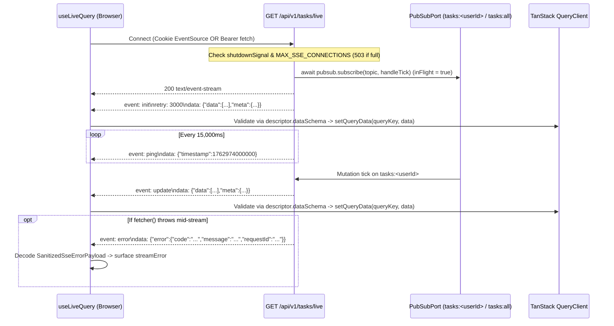

# Orval + Effect Schema Contract Generation, Error Decoding, and SSE Live-Query Client Patterns

> **Research Ticket:** [Guiguerreiro39/tanstack-open-api#3](https://github.com/Guiguerreiro39/tanstack-open-api/issues/3)  
> **Parent Map:** [Guiguerreiro39/tanstack-open-api#1](https://github.com/Guiguerreiro39/tanstack-open-api/issues/1)  
> **Status:** Resolved

---

## Executive Summary

1. **Eliminate Manual DTO Double-Declaration with Dual-Target Orval (`client: "react-query"` + `client: "effect"`) and `defineContract`:**
   - **Primary-source discovery:** Orval v8 (`orval@8.27.0`, already installed in `forklore-fe`) ships a first-party [`@orval/effect`](file:///Users/guilhermeguerreiro/Documents/Git/forklore-fe/node_modules/.pnpm/@orval+effect@8.27.0_supports-color@7.2.0_typescript@5.9.3/node_modules/@orval/effect/README.md) generator (`client: "effect"`) that emits Effect `Schema` (`import { Schema as S } from "effect"`) validators directly from `./openapi.json` for path params, query params, request bodies, and responses.
   - **Critical `@orval/effect` configuration (`generateEachHttpStatus: true`):** In [`@orval/effect/dist/index.mjs`](file:///Users/guilhermeguerreiro/Documents/Git/forklore-fe/node_modules/.pnpm/@orval+effect@8.27.0_supports-color@7.2.0_typescript@5.9.3/node_modules/@orval/effect/dist/index.mjs#L606-L609), `getSingleResponse()` only inspects `responses["200"] ?? responses["2XX"] ?? responses["2xx"]` when `generateEachHttpStatus` is `false`. Because `hono-open-api` returns `201 Created` on `POST /api/v1/tasks`, `POST /api/v1/files`, and `POST /api/v1/files/presign` ([ADR-0002](file:///Users/guilhermeguerreiro/Documents/Git/hono-open-api/docs/adr/0002-http-api-and-error-conventions.md#L19)), setting `override.effect.generateEachHttpStatus: true` is required so `PostApiV1Tasks201Response` and all per-status error schemas (`GetApiV1Tasks400Response`, `401`, `403`, `422`, etc.) are emitted.
   - **Critical `@orval/fetch` configuration (`includeHttpResponseReturnType: false`):** In `forklore-fe`, `orval.config.ts` left `override.fetch.includeHttpResponseReturnType` at its v8 default (`true`), causing Orval to type all query/mutation functions as returning `{ data: T, status: number, headers: Headers }` while [`customFetch`](file:///Users/guilhermeguerreiro/Documents/Git/forklore-fe/src/shared/api/client.ts#L61) actually returned unwrapped `response.json()`. Setting `override.fetch.includeHttpResponseReturnType: false` aligns Orval's TypeScript return types with `customFetch`, TanStack Router SSR query dehydration, and `queryClient.setQueryData`, allowing `useEffectQuery` and `useEffectMutation` to enforce `TQueryFnData extends I` at compile time.
   - **Zero-boilerplate `defineContract`:** By deriving `OperationErrorStatuses<Op>` at the type level from the generated `schemas.ts` namespace (`typeof import("./generated/schemas")`), `defineContract({ operation: "GetApiV1Tasks", path: "/api/v1/tasks", dataSchema: GetApiV1Tasks200Response })` infers `A`, `I`, and the exact scoped `E` union (`BadRequestError | UnauthorizedError | ForbiddenError | ValidationError | UnknownError`) with zero manual `Schema.Struct` definitions.

2. **Align Error Decoding & Cursor Pagination with `hono-open-api` ([`src/core/errors.ts`](file:///Users/guilhermeguerreiro/Documents/Git/hono-open-api/src/core/errors.ts), [`src/core/pagination.ts`](file:///Users/guilhermeguerreiro/Documents/Git/hono-open-api/src/core/pagination.ts)):**
   - `forklore-fe` assumed `stoker`'s legacy `{ message?: string, error?: { issues?: ... } }` payload and only mapped `401`, `404`, `409`, and `422`.
   - `hono-open-api` standardizes all errors (`400`, `401`, `403`, `404`, `408`, `409`, `413`, `422`, `429`, `500`, `503`) around `{ error: { code: string, message: string, requestId: string, details?: unknown } }` ([`ErrorResponseSchema`](file:///Users/guilhermeguerreiro/Documents/Git/hono-open-api/src/core/errors.ts#L156-L163)), placing Zod validation issues in `error.details` (`422`) and domain error codes in `error.code` (e.g., `"INVALID_CURSOR"` on `400`, `"FILE_PENDING"` on `409`).
   - Every `Data.TaggedError` in `AnyApiError` should carry `{ status, code, message, requestId, details? }`, and `customFetch` must fall back to `response.headers.get("x-request-id")`, preserve `FormData` headers for `POST /api/v1/files`, and handle `Blob` responses for `GET /api/v1/files/{id}/download`.

3. **Redesign `useLiveQuery` for `hono-open-api`'s SSE Protocol ([`src/core/realtime/sse.ts`](file:///Users/guilhermeguerreiro/Documents/Git/hono-open-api/src/core/realtime/sse.ts), [ADR-0008](file:///Users/guilhermeguerreiro/Documents/Git/hono-open-api/docs/adr/0008-realtime-sse-and-pubsub.md)):**
   - `forklore-fe`'s [`useLiveQuery`](file:///Users/guilhermeguerreiro/Documents/Git/forklore-fe/src/shared/lib/hooks/use-live-query.ts) appended `?token=` (which `hono-open-api` rejects with `401`), ignored `init`, `ping`, and `error` events (missing initial/reconnect snapshots and server-side stream errors), and wrote unvalidated `JSON.parse` output into the TanStack Query cache.
   - The starter's `useLiveQuery` must support both browser `EventSource(..., { withCredentials: true })` (for Better Auth `HttpOnly` cookies) and `fetch()` + `eventsource-parser` (for `Authorization: Bearer <token>` with exponential backoff and non-retryable `4xx` circuit breaking), listen to `init` + `update` + `ping` + `error`, validate snapshots via `Schema.decodeUnknownEither(descriptor.dataSchema)` before calling `queryClient.setQueryData`, and build URLs with Orval's `getGetApiV1TasksLiveUrl(params)` so query parameters (`cursor`, `limit`, `scope`, `userId`) stay synchronized with the query key.

---

## Part 1: Eliminating Orval + Effect Schema Double-Declaration

### 1.1 Audit of `forklore-fe`'s Current Orval + Effect Architecture

In `forklore-fe`, the API layer is split across four locations:

- [`orval.config.ts`](file:///Users/guilhermeguerreiro/Documents/Git/forklore-fe/orval.config.ts#L1-L20): Configures a single Orval target (`client: "react-query"`, `httpClient: "fetch"`, `mode: "split"`) with `customFetch` mutator.
- [`src/shared/api/generated/endpoints.ts`](file:///Users/guilhermeguerreiro/Documents/Git/forklore-fe/src/shared/api/generated/endpoints.ts#L563-L632) & `models/`: Generated TypeScript interfaces and TanStack Query hooks.
- [`src/shared/api/dto/*.dto.ts`](file:///Users/guilhermeguerreiro/Documents/Git/forklore-fe/src/shared/api/dto/recipes.dto.ts#L1-L134): Hand-written Effect `Schema.Struct` definitions and `FunctionDescriptor` objects.
- [`src/shared/lib/hooks/use-effect-query.ts`](file:///Users/guilhermeguerreiro/Documents/Git/forklore-fe/src/shared/lib/hooks/use-effect-query.ts#L21-L69) & [`use-effect-mutation.ts`](file:///Users/guilhermeguerreiro/Documents/Git/forklore-fe/src/shared/lib/hooks/use-effect-mutation.ts#L26-L75): Wrappers around `useQuery` / `useMutation` adding `.toEffect()`.

Inspection of these primary sources reveals three structural problems:

1. **100% Schema Duplication:** Every OpenAPI response and request model in `src/shared/api/generated/models/` is manually re-written as a `Schema.Struct` in `src/shared/api/dto/*.dto.ts` (e.g., `RecipeStepSchema`, `RecipeIngredientSchema`, `RecipeSchema` in [`recipes.dto.ts`](file:///Users/guilhermeguerreiro/Documents/Git/forklore-fe/src/shared/api/dto/recipes.dto.ts#L12-L79), `UserSchema` in [`users.dto.ts`](file:///Users/guilhermeguerreiro/Documents/Git/forklore-fe/src/shared/api/dto/users.dto.ts#L12-L25)).
2. **Type-vs-Runtime Mismatch from Orval v8's `includeHttpResponseReturnType: true` Default:**
   - In [`@orval/fetch/dist/index.mjs`](file:///Users/guilhermeguerreiro/Documents/Git/forklore-fe/node_modules/.pnpm/@orval+fetch@8.27.0_supports-color@7.2.0_typescript@5.9.3/node_modules/@orval/fetch/dist/index.mjs#L196-L212), `override.fetch.includeHttpResponseReturnType` defaults to `true`.
   - Consequently, [`endpoints.ts`](file:///Users/guilhermeguerreiro/Documents/Git/forklore-fe/src/shared/api/generated/endpoints.ts#L563-L599) declares `getRecipes` as returning `Promise<{ data: GetRecipes200Item[]; status: 200; headers: Headers } | { data: GetRecipes401; status: 401; headers: Headers }>`.
   - However, [`customFetch<T>`](file:///Users/guilhermeguerreiro/Documents/Git/forklore-fe/src/shared/api/client.ts#L43-L62) throws `FetchError` on `!response.ok` and returns `response.json()` directly (`GetRecipes200Item[]`, **not** `{ data, status, headers }`).
3. **Unconstrained Type Parameters in `useEffectQuery` / `useEffectMutation`:**
   - In [`use-effect-query.ts`](file:///Users/guilhermeguerreiro/Documents/Git/forklore-fe/src/shared/lib/hooks/use-effect-query.ts#L21-L31), `TQueryFnData` and the descriptor's `A, E, I` have no type constraint between them (`TQueryFnData` is independent of `I` and `A`).
   - This hid the `{ data, status, headers }` mismatch above, and also means passing `getGetRecipesIdQueryOptions(id)` alongside `usersListDescriptor` compiles without any TypeScript error and only fails at runtime with `SchemaDecodeError`.

### 1.2 Primary-Source Analysis of `@orval/effect` in Orval v8.27.0

Orval v8.27.0 bundles [`@orval/effect`](file:///Users/guilhermeguerreiro/Documents/Git/forklore-fe/node_modules/.pnpm/@orval+effect@8.27.0_supports-color@7.2.0_typescript@5.9.3/node_modules/@orval/effect/dist/index.mjs) (`OutputClient.EFFECT = "effect"` in [`@orval/core/dist/index.d.mts`](file:///Users/guilhermeguerreiro/Documents/Git/forklore-fe/node_modules/.pnpm/@orval+core@8.27.0_supports-color@7.2.0_typescript@5.9.3/node_modules/@orval/core/dist/index.d.mts#L438)). Reading `@orval/effect/dist/index.mjs` directly establishes its exact behavior against `hono-open-api`'s OpenAPI 3.0 specification:

- **Per-Status Response Emission (`override.effect.generateEachHttpStatus`):**
  - At [`@orval/effect/dist/index.mjs#L606-L609`](file:///Users/guilhermeguerreiro/Documents/Git/forklore-fe/node_modules/.pnpm/@orval+effect@8.27.0_supports-color@7.2.0_typescript@5.9.3/node_modules/@orval/effect/dist/index.mjs#L606-L609):

    ```js
    const getSingleResponse = (responses) => {
      if (!responses) return;
      return responses["200"] ?? responses["2XX"] ?? responses["2xx"];
    };
    ```
  - When `generateEachHttpStatus` is `false` (default), `201 Created` endpoints (`POST /api/v1/tasks`, `POST /api/v1/files`, `POST /api/v1/files/presign`) emit **no response schema**.
  - When `override.effect.generateEachHttpStatus: true` is enabled ([`@orval/effect/dist/index.mjs#L707-L743`](file:///Users/guilhermeguerreiro/Documents/Git/forklore-fe/node_modules/.pnpm/@orval+effect@8.27.0_supports-color@7.2.0_typescript@5.9.3/node_modules/@orval/effect/dist/index.mjs#L707-L743)), `@orval/effect` iterates `Object.entries(spec[verb]?.responses ?? {})` and emits a named Effect `Schema` for every HTTP status with a JSON or multipart payload (`GetApiV1Tasks200Response`, `PostApiV1Tasks201Response`, `GetApiV1Tasks400Response`, `GetApiV1Tasks401Response`, etc.).
- **OpenAPI Format & Constraint Mapping ([`@orval/effect/dist/index.mjs#L184-L366`](file:///Users/guilhermeguerreiro/Documents/Git/forklore-fe/node_modules/.pnpm/@orval+effect@8.27.0_supports-color@7.2.0_typescript@5.9.3/node_modules/@orval/effect/dist/index.mjs#L184-L366)):**
  - `z.uuid()` (`format: "uuid"`) -> `S.String.pipe(S.pattern(/^[0-9a-fA-F]{8}-[0-9a-fA-F]{4}-[0-9a-fA-F]{4}-[0-9a-fA-F]{4}-[0-9a-fA-F]{12}$/))`
  - `z.iso.datetime()` (`format: "date-time"`) -> `S.String.pipe(S.pattern(/^\d{4}-\d{2}-\d{2}T\d{2}:\d{2}:\d{2}(\.\d+)?(Z|[+-]\d{2}:?\d{2})?$/))` when `override.useDates` is `false` (or `S.DateFromString` when `override.useDates: true`).
  - `z.email()` (`format: "email"`) -> `S.String.pipe(S.pattern(/^[^\s@]+@[^\s@]+\.[^\s@]+$/))`
  - `z.instanceof(File).openapi({ type: "string", format: "binary" })` -> `S.Struct({ "file": S.instanceOf(File) })` (`PostApiV1FilesBody`).
  - `minLength` / `maxLength` / `minimum` / `maximum` / `exclusiveMinimum` / `default` -> `S.minLength`, `S.maxLength`, `S.greaterThanOrEqualTo`, `S.lessThanOrEqualTo`, `S.greaterThan`, `S.optionalWith(..., { default: () => ... })`.

### 1.3 Comparison of Contract Generation Approaches

| Approach                                                                      | How It Works                                                                                                                                                                                                                                                                                  | Pros                                                                                                                                                                                                                                               | Cons                                                                                                                                                                                                                              | Verdict         |
| ----------------------------------------------------------------------------- | --------------------------------------------------------------------------------------------------------------------------------------------------------------------------------------------------------------------------------------------------------------------------------------------- | -------------------------------------------------------------------------------------------------------------------------------------------------------------------------------------------------------------------------------------------------- | --------------------------------------------------------------------------------------------------------------------------------------------------------------------------------------------------------------------------------- | --------------- |
| **A. Dual-Target Orval (`react-query` + `effect`) + `defineContract` helper** | `orval.config.ts` runs `client: "react-query"` (`includeHttpResponseReturnType: false`) and `client: "effect"` (`generateEachHttpStatus: true`). `defineContract` pairs an Orval operation with its generated Effect `Schema` and derives `E` from the generated `*<Status>Response` exports. | Zero manual `Schema.Struct` writing; native Effect `Schema` AST (`Schema.standardSchemaV1` works in TanStack Form & Router); compile-time `TQueryFnData extends I` enforcement; allows overriding `dataSchema` with custom transforms when needed. | Requires `generateEachHttpStatus: true` in `orval.config.ts` so `201` routes are emitted.                                                                                                                                         | **Recommended** |
| **B. Orval `zod` + Standard Schema bridge**                                   | Generate Zod schemas (`client: "zod"`) and bridge into Effect via `@standard-schema/spec`.                                                                                                                                                                                                    | Orval supports `includeZodSchemaInArguments`.                                                                                                                                                                                                      | Loses native Effect `Schema` combinators, `Encoded`/`Type` duality, бренding, and `SchemaDecodeError` AST formatting; requires keeping both `zod` and `effect` validation libraries in the frontend bundle.                       | Rejected        |
| **C. Manual `src/shared/api/dto/*.dto.ts` (Current `forklore-fe`)**           | Hand-write `Schema.Struct` and `FunctionDescriptor<A, E, I>` per endpoint.                                                                                                                                                                                                                    | Full manual control over every field.                                                                                                                                                                                                              | High maintenance toil; drifts silently from OpenAPI spec; 130+ lines of boilerplate per module.                                                                                                                                   | Rejected        |
| **D. Hono RPC (`hc<AppType>`) without Orval**                                 | Import `AppType` from backend monorepo workspace.                                                                                                                                                                                                                                             | Zero codegen step in monorepos.                                                                                                                                                                                                                    | Couples frontend build to backend TypeScript source (violating standalone repo separation between `hono-open-api` and `tanstack-open-api`); provides no runtime `Effect.Schema` validation or TanStack Query key/hook generation. | Rejected        |

### 1.4 Recommended Configuration & Contract Factory

#### `orval.config.ts`

```ts
import { defineConfig } from "orval";

export default defineConfig({
  api: {
    input: "./openapi.json",
    output: {
      mode: "split",
      target: "src/shared/api/generated/endpoints.ts",
      schemas: "src/shared/api/generated/models",
      client: "react-query",
      httpClient: "fetch",
      override: {
        mutator: {
          path: "./src/shared/api/client.ts",
          name: "customFetch",
        },
        fetch: {
          // Crucial: customFetch unwraps response.json() and throws FetchError on !response.ok
          includeHttpResponseReturnType: false,
        },
        query: {
          useQuery: true,
          useMutation: true,
          useInfinite: true,
          // Emits useGetApiV1TasksInfinite / useGetApiV1FilesInfinite only for routes with `cursor`
          useInfiniteQueryParam: "cursor",
        },
      },
    },
  },
  apiEffectSchemas: {
    input: "./openapi.json",
    output: {
      mode: "single",
      target: "src/shared/api/generated/schemas.ts",
      client: "effect",
      override: {
        effect: {
          // Crucial: emits 201 Created responses and per-status error schemas (400, 401, 403, etc.)
          generateEachHttpStatus: true,
        },
      },
    },
  },
});
```

#### Automated `OperationErrorStatuses<Op>` & `defineContract` (`src/shared/api/contracts.ts`)

Because `src/shared/api/generated/schemas.ts` exports a symbol named `<Operation><Status>Response` for every status code declared in `hono-open-api`'s route spec (e.g., `GetApiV1Tasks200Response`, `GetApiV1Tasks400Response`, `GetApiV1Tasks401Response`, `GetApiV1Tasks403Response`, `GetApiV1Tasks422Response`), TypeScript template-literal types can extract the exact error status union from the operation prefix automatically:

```ts
import { Schema } from "effect";
import type * as apiSchemas from "./generated/schemas";
import { decodeApiError, type ApiErrorStatus, type StatusToEffectError } from "./errors";

type GeneratedSchemas = typeof apiSchemas;

/** All operation prefixes emitted by @orval/effect (e.g. "GetApiV1Tasks", "PostApiV1Files") */
export type OperationPrefix = {
  [K in keyof GeneratedSchemas]: K extends `${infer Op}${number}Response` ? Op : never;
}[keyof GeneratedSchemas];

/** Extracts all non-2xx HTTP status codes declared on an OpenAPI operation */
export type OperationErrorStatuses<Op extends string> = {
  [K in keyof GeneratedSchemas]: K extends `${Op}${infer Code extends number}Response`
    ? Code extends 200 | 201 | 202 | 204
      ? never
      : Code
    : never;
}[keyof GeneratedSchemas];

export interface FunctionDescriptor<A, E, I = unknown> {
  readonly path: string;
  readonly dataSchema: Schema.Schema<A, I, never>;
  readonly decodeError?: (error: unknown) => E;
}

/**
 * Define an API contract backed by an @orval/effect schema and automatic OpenAPI error status inference.
 */
export function defineContract<
  Op extends OperationPrefix,
  S extends Schema.Schema.AnyNoContext,
>(options: {
  readonly operation: Op;
  readonly path: string;
  readonly dataSchema: S;
}): FunctionDescriptor<
  Schema.Schema.Type<S>,
  StatusToEffectError<OperationErrorStatuses<Op>>,
  Schema.Schema.Encoded<S>
>;
export function defineContract<
  S extends Schema.Schema.AnyNoContext,
  const TStatuses extends readonly ApiErrorStatus[] = readonly [],
>(options: {
  readonly path: string;
  readonly dataSchema: S;
  readonly errors?: TStatuses;
}): FunctionDescriptor<
  Schema.Schema.Type<S>,
  StatusToEffectError<TStatuses[number]>,
  Schema.Schema.Encoded<S>
>;
export function defineContract(options: {
  readonly operation?: string;
  readonly path: string;
  readonly dataSchema: Schema.Schema.AnyNoContext;
  readonly errors?: readonly ApiErrorStatus[];
}): FunctionDescriptor<unknown, unknown, unknown> {
  return {
    path: options.path,
    dataSchema: options.dataSchema,
    decodeError: decodeApiError,
  };
}
```

With this setup, an entire feature module's contracts shrink from ~130 lines of duplicated structs to 3-line declarations:

```ts
// src/features/tasks/api/tasks.contracts.ts
import { Schema } from "effect";
import { defineContract } from "@/shared/api/contracts";
import {
  GetApiV1Tasks200Response,
  GetApiV1TasksId200Response,
  PatchApiV1TasksId200Response,
  PostApiV1Tasks201Response,
} from "@/shared/api/generated/schemas";

export const listTasksContract = defineContract({
  operation: "GetApiV1Tasks",
  path: "/api/v1/tasks",
  dataSchema: GetApiV1Tasks200Response,
});

export const getTaskContract = defineContract({
  operation: "GetApiV1TasksId",
  path: "/api/v1/tasks/:id",
  dataSchema: GetApiV1TasksId200Response,
});

export const createTaskContract = defineContract({
  operation: "PostApiV1Tasks",
  path: "/api/v1/tasks",
  dataSchema: PostApiV1Tasks201Response,
});

export const updateTaskContract = defineContract({
  operation: "PatchApiV1TasksId",
  path: "/api/v1/tasks/:id",
  dataSchema: PatchApiV1TasksId200Response,
});

export const deleteTaskContract = defineContract({
  operation: "DeleteApiV1TasksId",
  path: "/api/v1/tasks/:id",
  dataSchema: Schema.Void,
});
```

#### Enforcing Compile-Time Alignment in `useEffectQuery` and `useEffectMutation`

With `includeHttpResponseReturnType: false`, `TQueryFnData` (e.g. `GetApiV1Tasks200`) is directly assignable to `I` (`Schema.Schema.Encoded<typeof GetApiV1Tasks200Response>`). Constraining `TQueryFnData extends I` in `useEffectQuery` and `TData extends I` in `useEffectMutation` catches any mismatched `(queryOptions, descriptor)` pair at compile time while memoizing `toEffect()`:

```ts
export function useEffectQuery<
  TQueryFnData extends I,
  A,
  E,
  I = unknown,
  TError = unknown,
  TQueryKey extends QueryKey = QueryKey,
>(
  queryOptions: UseQueryOptions<TQueryFnData, TError, TQueryFnData, TQueryKey>,
  descriptor: FunctionDescriptor<A, E, I>,
): UseEffectQueryResult<A, E>;
```

#### Bonus: Reusing `@orval/effect` Request Schemas with `@tanstack/react-form` and `@tanstack/react-router`

Because Effect `Schema` (`effect >= 3.13.0`) implements Standard Schema v1 via `Schema.standardSchemaV1(schema)`, the generated `*Body` and `*QueryParams` schemas in `src/shared/api/generated/schemas.ts` can be passed directly to:

- **TanStack Router `validateSearch`:** `validateSearch: Schema.standardSchemaV1(GetApiV1TasksQueryParams)`
- **TanStack Form `validators`:** `validators: { onSubmit: Schema.standardSchemaV1(PostApiV1TasksBody) }`

---

## Part 2: `hono-open-api` Error Envelope, Status Codes, and Cursor Pagination

### 2.1 Wire Format Comparison: `forklore-fe` vs `hono-open-api`

In `forklore-fe`:

- [`src/shared/api/client.ts#L1-L11`](file:///Users/guilhermeguerreiro/Documents/Git/forklore-fe/src/shared/api/client.ts#L1-L11) defined `HttpErrorPayload` as `{ message?: string; error?: { issues?: Array<{ code?: string; path?: Array<string | number>; message?: string }>; name?: string } }`.
- [`src/shared/api/contracts.ts#L51-L79`](file:///Users/guilhermeguerreiro/Documents/Git/forklore-fe/src/shared/api/contracts.ts#L51-L79) read `err.data?.message` and `err.data?.error?.issues`, and only handled HTTP `401`, `404`, `409`, and `422`.

In `hono-open-api` ([`src/core/errors.ts#L156-L303`](file:///Users/guilhermeguerreiro/Documents/Git/hono-open-api/src/core/errors.ts#L156-L303), [ADR-0002](file:///Users/guilhermeguerreiro/Documents/Git/hono-open-api/docs/adr/0002-http-api-and-error-conventions.md)):

- Every error response (`defaultHook` on `422`, `notFoundHandler` on `404`, `createErrorHandler` on `AppError` / `HTTPException` / unhandled `500`, and mid-stream SSE `event: error`) uses a single canonical JSON envelope:

  ```ts
  export const ErrorResponseSchema = z.object({
    error: z.object({
      code: z.string(),
      message: z.string(),
      requestId: z.string(),
      details: z.unknown().optional(),
    }),
  });
  ```
- Under `forklore-fe`'s old decoder, `err.data?.message` is always `undefined` (because `message` is nested under `err.data.error.message`), `err.data?.error?.issues` is always `undefined` (because `defaultHook` at [`src/core/errors.ts#L229`](file:///Users/guilhermeguerreiro/Documents/Git/hono-open-api/src/core/errors.ts#L229) writes `details: result.error.issues`), and `error.code` / `error.requestId` are discarded.

### 2.2 Complete Status & Error Code Matrix in `hono-open-api`

| HTTP Status | `hono-open-api` Source                                                                                                                                                                                                                           | Default `error.code`      | Domain-Specific `error.code` Overrides & Context                                                                                                                                                      | Effect `Data.TaggedError` Class |
| ----------- | ------------------------------------------------------------------------------------------------------------------------------------------------------------------------------------------------------------------------------------------------ | ------------------------- | ----------------------------------------------------------------------------------------------------------------------------------------------------------------------------------------------------- | ------------------------------- |
| `400`       | [`BadRequestError`](file:///Users/guilhermeguerreiro/Documents/Git/hono-open-api/src/core/errors.ts#L36-L46)                                                                                                                                     | `"BAD_REQUEST"`           | `"INVALID_CURSOR"` ([`src/core/pagination.ts#L37-L70`](file:///Users/guilhermeguerreiro/Documents/Git/hono-open-api/src/core/pagination.ts#L37-L70))                                                  | `BadRequestError`               |
| `401`       | [`UnauthorizedError`](file:///Users/guilhermeguerreiro/Documents/Git/hono-open-api/src/core/errors.ts#L48-L58)                                                                                                                                   | `"UNAUTHORIZED"`          | Missing/expired session or `?token=` query param on `requireAuth`                                                                                                                                     | `UnauthorizedError`             |
| `403`       | [`ForbiddenError`](file:///Users/guilhermeguerreiro/Documents/Git/hono-open-api/src/core/errors.ts#L60-L70)                                                                                                                                      | `"FORBIDDEN"`             | `user.banned === true`, RBAC permission check failure, non-admin `?scope=all` or `?userId=` ([`ADR-0004`](file:///Users/guilhermeguerreiro/Documents/Git/hono-open-api/docs/architecture.md#L80-L81)) | `ForbiddenError`                |
| `404`       | [`NotFoundError`](file:///Users/guilhermeguerreiro/Documents/Git/hono-open-api/src/core/errors.ts#L72-L82), [`notFoundHandler`](file:///Users/guilhermeguerreiro/Documents/Git/hono-open-api/src/core/errors.ts#L235-L243)                       | `"NOT_FOUND"`             | Missing entity, foreign entity ID for non-privileged user, or `/_storage/*` when S3 driver is active                                                                                                  | `NotFoundError`                 |
| `408`       | [`RequestTimeoutError`](file:///Users/guilhermeguerreiro/Documents/Git/hono-open-api/src/core/errors.ts#L84-L94), [`defaultTimeout`](file:///Users/guilhermeguerreiro/Documents/Git/hono-open-api/src/app.ts#L67-L70)                            | `"REQUEST_TIMEOUT"`       | Global `30s` request timeout middleware                                                                                                                                                               | `RequestTimeoutError`           |
| `409`       | [`ConflictError`](file:///Users/guilhermeguerreiro/Documents/Git/hono-open-api/src/core/errors.ts#L96-L106)                                                                                                                                      | `"CONFLICT"`              | `"FILE_PENDING"` on download/url/complete of unverified upload ([`files.service.ts`](file:///Users/guilhermeguerreiro/Documents/Git/hono-open-api/docs/architecture.md#L99)), DB unique constraint    | `ConflictError`                 |
| `413`       | [`PayloadTooLargeError`](file:///Users/guilhermeguerreiro/Documents/Git/hono-open-api/src/core/errors.ts#L108-L118), [`bodyLimit`](file:///Users/guilhermeguerreiro/Documents/Git/hono-open-api/src/app.ts#L60-L65)                              | `"PAYLOAD_TOO_LARGE"`     | `1 MB` global JSON limit or `STORAGE_MAX_FILE_SIZE_BYTES` upload limit                                                                                                                                | `PayloadTooLargeError`          |
| `422`       | [`ValidationError`](file:///Users/guilhermeguerreiro/Documents/Git/hono-open-api/src/core/errors.ts#L120-L130), [`defaultHook`](file:///Users/guilhermeguerreiro/Documents/Git/hono-open-api/src/core/errors.ts#L222-L233)                       | `"VALIDATION_ERROR"`      | `details` holds `ZodIssue[]` on OpenAPI validation failures, or MIME / magic-byte failure details in `files`                                                                                          | `ValidationError`               |
| `429`       | [`RateLimitError`](file:///Users/guilhermeguerreiro/Documents/Git/hono-open-api/src/core/errors.ts#L132-L142)                                                                                                                                    | `"RATE_LIMIT_EXCEEDED"`   | Route-group rate limiters (`10 req/min` auth/upload, `100 req/min` general)                                                                                                                           | `RateLimitError`                |
| `500`       | [`createErrorHandler`](file:///Users/guilhermeguerreiro/Documents/Git/hono-open-api/src/core/errors.ts#L258-L302)                                                                                                                                | `"INTERNAL_SERVER_ERROR"` | Wire message always sanitized to `"Internal server error"`                                                                                                                                            | `InternalServerError`           |
| `503`       | [`ServiceUnavailableError`](file:///Users/guilhermeguerreiro/Documents/Git/hono-open-api/src/core/errors.ts#L144-L154), [`GET /ready`](file:///Users/guilhermeguerreiro/Documents/Git/hono-open-api/src/modules/system/system.routes.ts#L55-L62) | `"SERVICE_UNAVAILABLE"`   | `MAX_SSE_CONNECTIONS` reached, graceful shutdown active, or `/ready` unhealthy probe (`{ status: "unhealthy", timestamp, checks }`)                                                                   | `ServiceUnavailableError`       |

### 2.3 Hardened `customFetch` & `FetchError` (`src/shared/api/client.ts`)

In addition to updating `HttpErrorPayload` for `hono-open-api`'s `{ error: { code, message, requestId, details? } }` envelope, inspecting `forklore-fe`'s [`src/shared/api/client.ts`](file:///Users/guilhermeguerreiro/Documents/Git/forklore-fe/src/shared/api/client.ts#L34-L62) against `hono-open-api`'s `files` module reveals two bugs that must be fixed in `customFetch`:

1. **`FormData` `Content-Type` Clobbering:** `forklore-fe`'s `customFetch` unconditionally set `"Content-Type": "application/json"` on every request ([`client.ts#L37`](file:///Users/guilhermeguerreiro/Documents/Git/forklore-fe/src/shared/api/client.ts#L37)). For `POST /api/v1/files`, Orval generates `const formData = new FormData(); formData.append('file', ...)` and omits `Content-Type` so the browser can attach `multipart/form-data; boundary=...`. Forcing `"Content-Type": "application/json"` breaks multipart file uploads.
2. **Binary `Blob` Responses (`GET /api/v1/files/{id}/download`):** `forklore-fe` unconditionally called `response.json()` ([`client.ts#L61`](file:///Users/guilhermeguerreiro/Documents/Git/forklore-fe/src/shared/api/client.ts#L61)), which throws a `SyntaxError` when downloading binary files (`application/octet-stream`).

```ts
// src/shared/api/client.ts
export interface ApiErrorDetailIssue {
  readonly code?: string;
  readonly path?: ReadonlyArray<string | number>;
  readonly message?: string;
}

export interface ApiErrorObject {
  readonly code: string;
  readonly message: string;
  readonly requestId: string;
  readonly details?: unknown;
}

export interface HttpErrorPayload {
  readonly error?: ApiErrorObject;
  readonly message?: string;
}

export class FetchError extends Error {
  readonly status: number;
  readonly code: string;
  readonly requestId: string;
  readonly details?: unknown;
  readonly data?: unknown;

  constructor(options: {
    status: number;
    code: string;
    message: string;
    requestId: string;
    details?: unknown;
    data?: unknown;
  }) {
    super(options.message);
    this.name = "FetchError";
    this.status = options.status;
    this.code = options.code;
    this.requestId = options.requestId;
    this.details = options.details;
    this.data = options.data;
  }
}

export function resolveApiUrl(url: string): string {
  if (url.startsWith("http://") || url.startsWith("https://")) {
    return url;
  }
  const envBaseUrl =
    import.meta.env.VITE_API_URL ||
    (typeof process !== "undefined" ? process.env?.VITE_API_URL : undefined);
  const baseURL = envBaseUrl || (typeof window !== "undefined" ? "" : "http://localhost:9999");
  return `${baseURL.replace(/\/$/, "")}${url.startsWith("/") ? url : `/${url}`}`;
}

export async function customFetch<T>(url: string, options: RequestInit = {}): Promise<T> {
  const fullUrl = resolveApiUrl(url);
  const isFormData = typeof FormData !== "undefined" && options.body instanceof FormData;

  const headers = new Headers(options.headers);
  if (!isFormData && options.body !== undefined && !headers.has("Content-Type")) {
    headers.set("Content-Type", "application/json");
  }

  const response = await fetch(fullUrl, {
    ...options,
    headers,
    credentials: options.credentials ?? "include",
  });

  if (!response.ok) {
    const headerRequestId = response.headers.get("x-request-id") ?? "unknown";
    let rawData: unknown;
    try {
      rawData = await response.json();
    } catch {
      rawData = undefined;
    }

    const payload = (typeof rawData === "object" && rawData !== null ? rawData : undefined) as
      | HttpErrorPayload
      | undefined;
    const apiErr = payload?.error;

    throw new FetchError({
      status: response.status,
      code: apiErr?.code ?? `HTTP_${response.status}`,
      message:
        apiErr?.message ??
        payload?.message ??
        (response.statusText || `HTTP error ${response.status}`),
      requestId: apiErr?.requestId ?? headerRequestId,
      details: apiErr?.details,
      data: rawData,
    });
  }

  if (response.status === 204 || response.status === 205) {
    return undefined as unknown as T;
  }

  const contentType = (response.headers.get("content-type") ?? "").toLowerCase();
  if (
    contentType.includes("application/octet-stream") ||
    (!contentType.includes("json") && !contentType.startsWith("text/"))
  ) {
    return (await response.blob()) as unknown as T;
  }

  return (await response.json()) as T;
}

export default customFetch;
```

### 2.4 Complete `Data.TaggedError` Hierarchy & `decodeApiError` (`src/shared/api/contracts.ts`)

```ts
// src/shared/api/contracts.ts
import { Data, Schema } from "effect";
import { FetchError, type ApiErrorDetailIssue } from "./client";

export interface BaseApiErrorFields {
  readonly status: number;
  readonly code: string;
  readonly message: string;
  readonly requestId: string;
  readonly details?: unknown;
}

export class SchemaDecodeError extends Data.TaggedError("SchemaDecodeError")<{
  readonly path: string;
  readonly cause: unknown;
}> {}

export class BadRequestError extends Data.TaggedError("BadRequestError")<
  BaseApiErrorFields & { readonly status: 400 }
> {}

export class UnauthorizedError extends Data.TaggedError("UnauthorizedError")<
  BaseApiErrorFields & { readonly status: 401 }
> {}

export class ForbiddenError extends Data.TaggedError("ForbiddenError")<
  BaseApiErrorFields & { readonly status: 403 }
> {}

export class NotFoundError extends Data.TaggedError("NotFoundError")<
  BaseApiErrorFields & { readonly status: 404 }
> {}

export class RequestTimeoutError extends Data.TaggedError("RequestTimeoutError")<
  BaseApiErrorFields & { readonly status: 408 }
> {}

export class ConflictError extends Data.TaggedError("ConflictError")<
  BaseApiErrorFields & { readonly status: 409 }
> {}

export class PayloadTooLargeError extends Data.TaggedError("PayloadTooLargeError")<
  BaseApiErrorFields & { readonly status: 413 }
> {}

export class ValidationError extends Data.TaggedError("ValidationError")<
  BaseApiErrorFields & {
    readonly status: 422;
    readonly issues: ReadonlyArray<ApiErrorDetailIssue>;
  }
> {}

export class RateLimitError extends Data.TaggedError("RateLimitError")<
  BaseApiErrorFields & { readonly status: 429 }
> {}

export class InternalServerError extends Data.TaggedError("InternalServerError")<
  BaseApiErrorFields & { readonly status: 500 }
> {}

export class ServiceUnavailableError extends Data.TaggedError("ServiceUnavailableError")<
  BaseApiErrorFields & { readonly status: 503; readonly data?: unknown }
> {}

export class UnknownError extends Data.TaggedError("UnknownError")<{
  readonly message: string;
  readonly status?: number;
  readonly code?: string;
  readonly requestId?: string;
  readonly cause?: unknown;
}> {}

export type AnyApiError =
  | BadRequestError
  | UnauthorizedError
  | ForbiddenError
  | NotFoundError
  | RequestTimeoutError
  | ConflictError
  | PayloadTooLargeError
  | ValidationError
  | RateLimitError
  | InternalServerError
  | ServiceUnavailableError
  | UnknownError;

export type ApiErrorStatus = 400 | 401 | 403 | 404 | 408 | 409 | 413 | 422 | 429 | 500 | 503;

/**
 * Maps OpenAPI error status codes to their corresponding Effect TaggedError union.
 * Always includes InternalServerError (500) and UnknownError (network/unexpected failures).
 */
export type StatusToEffectError<Status extends number> =
  | (400 extends Status ? BadRequestError : never)
  | (401 extends Status ? UnauthorizedError : never)
  | (403 extends Status ? ForbiddenError : never)
  | (404 extends Status ? NotFoundError : never)
  | (408 extends Status ? RequestTimeoutError : never)
  | (409 extends Status ? ConflictError : never)
  | (413 extends Status ? PayloadTooLargeError : never)
  | (422 extends Status ? ValidationError : never)
  | (429 extends Status ? RateLimitError : never)
  | (503 extends Status ? ServiceUnavailableError : never)
  | InternalServerError
  | UnknownError;

function extractValidationIssues(details: unknown): ReadonlyArray<ApiErrorDetailIssue> {
  if (!Array.isArray(details)) return [];
  return details.filter(
    (item): item is ApiErrorDetailIssue => typeof item === "object" && item !== null,
  );
}

export function decodeApiError(error: unknown): AnyApiError {
  if (
    error instanceof FetchError ||
    (typeof error === "object" && error !== null && "status" in error)
  ) {
    const err = error as FetchError;
    const status = err.status;
    const code = err.code ?? `HTTP_${status}`;
    const message = err.message || `HTTP error ${status}`;
    const requestId = err.requestId ?? "unknown";
    const details = err.details;

    switch (status) {
      case 400:
        return new BadRequestError({ status: 400, code, message, requestId, details });
      case 401:
        return new UnauthorizedError({ status: 401, code, message, requestId, details });
      case 403:
        return new ForbiddenError({ status: 403, code, message, requestId, details });
      case 404:
        return new NotFoundError({ status: 404, code, message, requestId, details });
      case 408:
        return new RequestTimeoutError({ status: 408, code, message, requestId, details });
      case 409:
        return new ConflictError({ status: 409, code, message, requestId, details });
      case 413:
        return new PayloadTooLargeError({ status: 413, code, message, requestId, details });
      case 422:
        return new ValidationError({
          status: 422,
          code,
          message,
          requestId,
          details,
          issues: extractValidationIssues(details),
        });
      case 429:
        return new RateLimitError({ status: 429, code, message, requestId, details });
      case 500:
        return new InternalServerError({ status: 500, code, message, requestId, details });
      case 503:
        return new ServiceUnavailableError({
          status: 503,
          code,
          message,
          requestId,
          details,
          data: err.data,
        });
      default:
        return new UnknownError({ status, code, message, requestId, cause: error });
    }
  }

  return new UnknownError({
    message: error instanceof Error ? error.message : String(error),
    cause: error,
  });
}
```

### 2.5 Cursor Pagination Alignment (`{ data, meta: { nextCursor, hasMore } }`)

In [`hono-open-api/src/core/pagination.ts#L13-L26`](file:///Users/guilhermeguerreiro/Documents/Git/hono-open-api/src/core/pagination.ts#L13-L26):

- Paginated endpoints (`GET /api/v1/tasks`, `GET /api/v1/tasks/live`, `GET /api/v1/files`) accept `{ cursor?: string, limit?: number (1..100, default 50), scope?: "own" | "all", userId?: string }`.
- Responses conform to `PaginatedResponse<T>`:

  ```ts
  export const PaginatedMetaSchema = Schema.Struct({
    nextCursor: Schema.NullOr(Schema.String),
    hasMore: Schema.Boolean,
  });

  export const createPaginatedSchema = <A, I>(itemSchema: Schema.Schema<A, I>) =>
    Schema.Struct({
      data: Schema.Array(itemSchema),
      meta: PaginatedMetaSchema,
    });
  ```
- **Invalid Cursor Handling:** If a client passes a tampered or malformed `cursor` query param (e.g., from a manually edited URL search param), `hono-open-api`'s [`decodeCursor`](file:///Users/guilhermeguerreiro/Documents/Git/hono-open-api/src/core/pagination.ts#L35-L54) throws `BadRequestError("Invalid pagination cursor", { code: "INVALID_CURSOR" })`. With `decodeApiError` above, the frontend can pattern-match on `Effect.catchTag("BadRequestError", (err) => err.code === "INVALID_CURSOR" ? resetCursor() : ...)` to automatically clear a stale/corrupt URL cursor.
- **Infinite Query Helper:** With `useInfinite: true` and `useInfiniteQueryParam: "cursor"` in `orval.config.ts`, Orval generates `getGetApiV1TasksInfiniteQueryOptions(params, { query: { getNextPageParam: (lastPage) => lastPage.meta.hasMore ? (lastPage.meta.nextCursor ?? undefined) : undefined } })`.

---

## Part 3: Realtime SSE Live Query Client Design (`useLiveQuery`)

### 3.1 Six Flaws Diagnosed in `forklore-fe`'s `useLiveQuery`

Comparing [`forklore-fe/src/shared/lib/hooks/use-live-query.ts`](file:///Users/guilhermeguerreiro/Documents/Git/forklore-fe/src/shared/lib/hooks/use-live-query.ts#L1-L101) with [`hono-open-api/src/core/realtime/sse.ts`](file:///Users/guilhermeguerreiro/Documents/Git/hono-open-api/src/core/realtime/sse.ts#L145-L380) and [ADR-0008](file:///Users/guilhermeguerreiro/Documents/Git/hono-open-api/docs/adr/0008-realtime-sse-and-pubsub.md) reveals six concrete incompatibilities:

1. **Query-String `?token=` Authentication Causes Immediate `401` ([`use-live-query.ts#L62`](file:///Users/guilhermeguerreiro/Documents/Git/forklore-fe/src/shared/lib/hooks/use-live-query.ts#L62)):**
   - `forklore-fe` appends `?token=${encodeURIComponent(token)}` to `liveUrl` and opens `new EventSource(fullUrl)`.
   - `hono-open-api` ([ADR-0008](file:///Users/guilhermeguerreiro/Documents/Git/hono-open-api/docs/adr/0008-realtime-sse-and-pubsub.md#L11), [`docs/development.md#L125`](file:///Users/guilhermeguerreiro/Documents/Git/hono-open-api/docs/development.md#L125)) rejects `?token=` query authentication with `401 UNAUTHORIZED` per RFC 6750 §2.3, requiring either `HttpOnly` session cookies (`EventSource(..., { withCredentials: true })`) or `Authorization: Bearer <token>` headers via `fetch()` + `eventsource-parser`.
2. **Ignores `event: init`, Breaking Reconnect Re-Sync & Doubling Initial Load ([`use-live-query.ts#L79`](file:///Users/guilhermeguerreiro/Documents/Git/forklore-fe/src/shared/lib/hooks/use-live-query.ts#L79)):**
   - `hono-open-api`'s `createLiveQueryStream` ([`sse.ts#L291-L378`](file:///Users/guilhermeguerreiro/Documents/Git/hono-open-api/src/core/realtime/sse.ts#L291-L378)) subscribes to `PubSubPort` before opening the stream and immediately sends `event: init` containing the full `{ data, meta }` snapshot plus `retry: 3000`.
   - On reconnect after a network drop, `hono-open-api` does not use `Last-Event-ID` ring buffers; instead, it re-synchronizes the client by sending a fresh `event: init` snapshot ([ADR-0008](file:///Users/guilhermeguerreiro/Documents/Git/hono-open-api/docs/adr/0008-realtime-sse-and-pubsub.md#L12)).
   - Because `forklore-fe` only listened to `event: update`, any mutations occurring during a disconnect were permanently lost after reconnect.
3. **Swallows Server-Sent `event: error` Frames ([`use-live-query.ts#L81-L83`](file:///Users/guilhermeguerreiro/Documents/Git/forklore-fe/src/shared/lib/hooks/use-live-query.ts#L81-L83)):**
   - If `fetcher()` fails during an `init` or `update` tick, `hono-open-api`'s `writeError` ([`sse.ts#L94-L124`](file:///Users/guilhermeguerreiro/Documents/Git/hono-open-api/src/core/realtime/sse.ts#L94-L124), [`#L216-L230`](file:///Users/guilhermeguerreiro/Documents/Git/hono-open-api/src/core/realtime/sse.ts#L216-L230)) writes an SSE `event: error` frame with JSON payload `{ error: { code, message, requestId } }`.
   - `forklore-fe` had a no-op `eventSource.onerror = () => {}` and never inspected `event instanceof MessageEvent && event.data`.
4. **Ignores `event: ping` Heartbeats ([`sse.ts#L241-L254`](file:///Users/guilhermeguerreiro/Documents/Git/hono-open-api/src/core/realtime/sse.ts#L241-L254)):**
   - `hono-open-api` emits `event: ping` with `{ timestamp: Date.now() }` every `15_000ms` (`DEFAULT_SSE_HEARTBEAT_MS`). `forklore-fe` neither listened to `ping` nor exposed connection status (`connecting` / `connected` / `reconnecting` / `error`) to UI components.
5. **Writes Unvalidated `JSON.parse` Output to TanStack Query Cache ([`use-live-query.ts#L70-L73`](file:///Users/guilhermeguerreiro/Documents/Git/forklore-fe/src/shared/lib/hooks/use-live-query.ts#L70-L73)):**
   - `forklore-fe` wrote `JSON.parse(event.data)` directly into `queryClient.setQueryData` without validating against `descriptor.dataSchema`.
6. **Hardcoded `liveUrl` Drops Query Parameters (`cursor`, `limit`, `scope`, `userId`):**
   - In [`forklore-fe/src/features/recipes/api/get-all.ts#L12`](file:///Users/guilhermeguerreiro/Documents/Git/forklore-fe/src/features/recipes/api/get-all.ts#L12), `liveUrl` was hardcoded without query params. In `hono-open-api`, `GET /api/v1/tasks/live` accepts `ListTasksQuerySchema` (`cursor`, `limit`, `scope`, `userId`), and Orval generates `getGetApiV1TasksLiveUrl(params)` so the live stream filters and paginates identically to `getGetApiV1TasksQueryOptions(params)`.

### 3.2 `hono-open-api` SSE Protocol State Machine



### 3.3 Dual-Transport `useLiveQuery` Design (`EventSource` + `fetch`/`eventsource-parser`)

The starter should add `eventsource-parser` (`^3.0.1`) to `dependencies` and implement `useLiveQuery` with automatic transport selection:

- **Cookie mode (default when `getBearerToken` / `bearerToken` is omitted):** Uses `new EventSource(fullUrl, { withCredentials: true })`. Browser handles `retry: 3000` reconnection natively.
- **Bearer mode (when `bearerToken` or `getBearerToken` is provided):** Uses `fetch(fullUrl, { headers: { Authorization: "Bearer ...", Accept: "text/event-stream" }, signal })` + `createParser` from `eventsource-parser` ([`docs/development.md#L178-L290`](file:///Users/guilhermeguerreiro/Documents/Git/hono-open-api/docs/development.md#L178-L290)).
  - **Pre-stream HTTP status discrimination:** Non-retryable `4xx` responses (`400`, `401`, `403`, `404`, `422`) parse the ADR-0002 JSON error body, decode it via `decodeApiError`, set `liveStatus = "error"`, and **abort retry loops**. Transient statuses (`429`, `502`, `503`, `504`) and network drops retry with exponential backoff (`Math.min(maxDelayMs, baseDelayMs * 2 ** attempt)`), respecting any server `retry:` directive received via `onRetry`.

```ts
// src/shared/lib/hooks/use-live-query.ts
import type { AnyApiError, FunctionDescriptor } from "@/shared/api/contracts";
import { SchemaDecodeError, decodeApiError } from "@/shared/api/contracts";
import { FetchError, resolveApiUrl } from "@/shared/api/client";
import type { QueryKey, UseQueryOptions } from "@tanstack/react-query";
import { useQueryClient } from "@tanstack/react-query";
import { Schema } from "effect";
import { createParser } from "eventsource-parser";
import { useEffect, useRef, useState } from "react";
import type { UseEffectQueryResult } from "./use-effect-query";
import { useEffectQuery } from "./use-effect-query";

export type LiveConnectionStatus = "idle" | "connecting" | "connected" | "reconnecting" | "error";

export interface UseLiveQueryOptions<
  TQueryFnData extends I,
  A,
  E,
  I = unknown,
  TError = unknown,
  TQueryKey extends QueryKey = QueryKey,
> {
  readonly queryOptions: UseQueryOptions<TQueryFnData, TError, TQueryFnData, TQueryKey>;
  readonly descriptor: FunctionDescriptor<A, E, I>;
  /** Relative or absolute SSE path — pass Orval's `getGetApiV1TasksLiveUrl(params)` */
  readonly liveUrl: string;
  /** Optional Bearer token or async getter; when omitted, uses EventSource with HttpOnly cookies */
  readonly bearerToken?:
    | string
    | (() => string | null | undefined | Promise<string | null | undefined>);
  readonly enabled?: boolean;
  readonly baseDelayMs?: number;
  readonly maxDelayMs?: number;
  readonly onStreamError?: (error: AnyApiError | SchemaDecodeError) => void;
}

export type UseLiveQueryResult<A, E> = UseEffectQueryResult<A, E> & {
  readonly liveStatus: LiveConnectionStatus;
  readonly streamError: AnyApiError | SchemaDecodeError | null;
  readonly lastPingAt: number | null;
};

interface SseErrorEnvelope {
  readonly error?: {
    readonly code?: string;
    readonly message?: string;
    readonly requestId?: string;
  };
}

function decodeSseErrorFrame(raw: string): AnyApiError {
  try {
    const parsed = JSON.parse(raw) as SseErrorEnvelope;
    if (parsed?.error) {
      const code = parsed.error.code ?? "INTERNAL_SERVER_ERROR";
      const status =
        code === "UNAUTHORIZED"
          ? 401
          : code === "FORBIDDEN"
            ? 403
            : code === "NOT_FOUND"
              ? 404
              : code === "INVALID_CURSOR" || code === "BAD_REQUEST"
                ? 400
                : code === "VALIDATION_ERROR"
                  ? 422
                  : code === "RATE_LIMIT_EXCEEDED"
                    ? 429
                    : code === "SERVICE_UNAVAILABLE"
                      ? 503
                      : 500;
      return decodeApiError(
        new FetchError({
          status,
          code,
          message: parsed.error.message ?? "SSE stream error",
          requestId: parsed.error.requestId ?? "unknown",
        }),
      );
    }
  } catch {
    // Fall through to UnknownError
  }
  return decodeApiError(new Error(raw || "SSE stream error"));
}

export function useLiveQuery<
  TQueryFnData extends I,
  A,
  E,
  I = unknown,
  TError = unknown,
  TQueryKey extends QueryKey = QueryKey,
>(
  options: UseLiveQueryOptions<TQueryFnData, A, E, I, TError, TQueryKey>,
): UseLiveQueryResult<A, E> {
  const {
    queryOptions,
    descriptor,
    liveUrl,
    bearerToken,
    enabled = true,
    baseDelayMs = 1_000,
    maxDelayMs = 30_000,
    onStreamError,
  } = options;

  const queryClient = useQueryClient();
  const isEnabled = queryOptions.enabled !== false && enabled;

  const [liveStatus, setLiveStatus] = useState<LiveConnectionStatus>(
    isEnabled ? "connecting" : "idle",
  );
  const [streamError, setStreamError] = useState<AnyApiError | SchemaDecodeError | null>(null);
  const [lastPingAt, setLastPingAt] = useState<number | null>(null);

  const queryResult = useEffectQuery(
    {
      ...queryOptions,
      enabled: isEnabled,
      // While SSE is connected and pushing init/update snapshots, avoid redundant focus refetches
      staleTime: liveStatus === "connected" ? Number.POSITIVE_INFINITY : queryOptions.staleTime,
    },
    descriptor,
  );

  const queryKeyRef = useRef(queryOptions.queryKey);
  queryKeyRef.current = queryOptions.queryKey;
  const descriptorRef = useRef(descriptor);
  descriptorRef.current = descriptor;
  const onStreamErrorRef = useRef(onStreamError);
  onStreamErrorRef.current = onStreamError;
  const bearerTokenRef = useRef(bearerToken);
  bearerTokenRef.current = bearerToken;

  const queryKeySerialized = JSON.stringify(queryOptions.queryKey);
  const hasBearerMode = bearerToken !== undefined;

  useEffect(() => {
    if (!isEnabled) {
      setLiveStatus("idle");
      return;
    }

    const fullUrl = resolveApiUrl(liveUrl);
    setLiveStatus("connecting");
    setStreamError(null);

    const handleSnapshotData = (rawData: string) => {
      let parsed: unknown;
      try {
        parsed = JSON.parse(rawData);
      } catch (cause) {
        const err = new SchemaDecodeError({ path: descriptorRef.current.path, cause });
        setStreamError(err);
        onStreamErrorRef.current?.(err);
        return;
      }

      const validation = Schema.decodeUnknownEither(descriptorRef.current.dataSchema)(parsed);
      if (validation._tag === "Left") {
        const err = new SchemaDecodeError({
          path: descriptorRef.current.path,
          cause: validation.left,
        });
        setStreamError(err);
        onStreamErrorRef.current?.(err);
        return;
      }

      setStreamError(null);
      setLiveStatus("connected");
      queryClient.setQueryData(queryKeyRef.current, parsed as TQueryFnData);
    };

    const handlePingData = (rawData: string) => {
      try {
        const parsed = JSON.parse(rawData) as { timestamp?: number };
        setLastPingAt(typeof parsed.timestamp === "number" ? parsed.timestamp : Date.now());
      } catch {
        setLastPingAt(Date.now());
      }
      setLiveStatus("connected");
    };

    // Mode 1: Cookie-based browser EventSource (no ?token= query param)
    if (!hasBearerMode) {
      const source = new EventSource(fullUrl, { withCredentials: true });

      const onSnapshot = (event: MessageEvent<string>) => handleSnapshotData(event.data);
      const onPing = (event: MessageEvent<string>) => handlePingData(event.data);
      const onError = (event: Event) => {
        if (
          event instanceof MessageEvent &&
          typeof event.data === "string" &&
          event.data.length > 0
        ) {
          const decoded = decodeSseErrorFrame(event.data);
          setStreamError(decoded);
          onStreamErrorRef.current?.(decoded);
          return;
        }
        if (source.readyState === EventSource.CLOSED) {
          setLiveStatus("error");
        } else {
          setLiveStatus("reconnecting");
        }
      };

      source.addEventListener("init", onSnapshot);
      source.addEventListener("update", onSnapshot);
      source.addEventListener("ping", onPing);
      source.addEventListener("error", onError);

      return () => {
        source.removeEventListener("init", onSnapshot);
        source.removeEventListener("update", onSnapshot);
        source.removeEventListener("ping", onPing);
        source.removeEventListener("error", onError);
        source.close();
      };
    }

    // Mode 2: Bearer token via fetch() + eventsource-parser with exponential backoff
    const controller = new AbortController();
    const { signal } = controller;

    void (async () => {
      let attempt = 0;
      let serverRetryMs: number | undefined;

      while (!signal.aborted) {
        try {
          const tokenSource = bearerTokenRef.current;
          const resolvedToken =
            typeof tokenSource === "function" ? await tokenSource() : tokenSource;

          if (!resolvedToken) {
            const err = decodeApiError(
              new FetchError({
                status: 401,
                code: "UNAUTHORIZED",
                message: "Missing Bearer token for live stream",
                requestId: "unknown",
              }),
            );
            setStreamError(err);
            setLiveStatus("error");
            onStreamErrorRef.current?.(err);
            return;
          }

          const response = await fetch(fullUrl, {
            method: "GET",
            headers: {
              Authorization: `Bearer ${resolvedToken}`,
              Accept: "text/event-stream",
            },
            credentials: "include",
            signal,
          });

          if (!response.ok) {
            const headerRequestId = response.headers.get("x-request-id") ?? "unknown";
            let rawBody: unknown;
            try {
              rawBody = await response.json();
            } catch {
              rawBody = undefined;
            }
            const env = (rawBody as SseErrorEnvelope | undefined)?.error;
            const fetchErr = new FetchError({
              status: response.status,
              code: env?.code ?? `HTTP_${response.status}`,
              message: env?.message ?? (response.statusText || `HTTP ${response.status}`),
              requestId: env?.requestId ?? headerRequestId,
              data: rawBody,
            });
            const decodedErr = decodeApiError(fetchErr);
            setStreamError(decodedErr);
            onStreamErrorRef.current?.(decodedErr);

            // Non-retryable 4xx (400, 401, 403, 404, 422): stop retrying
            if (response.status >= 400 && response.status < 500 && response.status !== 429) {
              setLiveStatus("error");
              return;
            }
            throw fetchErr;
          }

          if (!response.body) {
            throw new Error("SSE response missing readable body");
          }

          attempt = 0;
          const parser = createParser({
            onRetry(retryMs) {
              serverRetryMs = retryMs;
            },
            onEvent(event) {
              if (event.event === "init" || event.event === "update") {
                handleSnapshotData(event.data);
              } else if (event.event === "ping") {
                handlePingData(event.data);
              } else if (event.event === "error") {
                const decoded = decodeSseErrorFrame(event.data);
                setStreamError(decoded);
                onStreamErrorRef.current?.(decoded);
              }
            },
          });

          const reader = response.body.getReader();
          const decoder = new TextDecoder();

          while (!signal.aborted) {
            const { done, value } = await reader.read();
            if (done) break;
            parser.feed(decoder.decode(value, { stream: true }));
          }
        } catch {
          if (signal.aborted) return;
        }

        if (signal.aborted) return;
        setLiveStatus("reconnecting");

        const base = serverRetryMs ?? baseDelayMs;
        const delayMs = Math.min(maxDelayMs, base * 2 ** attempt);
        attempt += 1;

        await new Promise<void>((resolve) => {
          const timer = setTimeout(resolve, delayMs);
          signal.addEventListener(
            "abort",
            () => {
              clearTimeout(timer);
              resolve();
            },
            { once: true },
          );
        });
      }
    })();

    return () => {
      controller.abort();
    };
  }, [liveUrl, isEnabled, hasBearerMode, baseDelayMs, maxDelayMs, queryClient, queryKeySerialized]);

  return {
    ...queryResult,
    liveStatus,
    streamError,
    lastPingAt,
  };
}
```

#### Feature Hook Usage (`useLiveTasks`)

```ts
// src/features/tasks/api/use-live-tasks.ts
import { listTasksContract } from "./tasks.contracts";
import {
  getGetApiV1TasksLiveUrl,
  getGetApiV1TasksQueryOptions,
} from "@/shared/api/generated/endpoints";
import type { GetApiV1TasksParams } from "@/shared/api/generated/models";
import { useSession } from "@/shared/lib/auth-client";
import { useLiveQuery } from "@/shared/lib/hooks/use-live-query";

export function useLiveTasks(params?: GetApiV1TasksParams) {
  const { data: session } = useSession();
  return useLiveQuery({
    queryOptions: getGetApiV1TasksQueryOptions(params),
    descriptor: listTasksContract,
    liveUrl: getGetApiV1TasksLiveUrl(params),
    enabled: Boolean(session?.user),
  });
}
```

---

## Primary Sources Cited

- **`hono-open-api` Backend Repository:**
  - [`src/core/errors.ts`](file:///Users/guilhermeguerreiro/Documents/Git/hono-open-api/src/core/errors.ts#L1-L303) — `AppError` subclasses (`400`, `401`, `403`, `404`, `408`, `409`, `413`, `422`, `429`, `500`, `503`), `ErrorResponseSchema`, `createErrorResponses`, `defaultHook`, `notFoundHandler`, `createErrorHandler`.
  - [`src/core/pagination.ts`](file:///Users/guilhermeguerreiro/Documents/Git/hono-open-api/src/core/pagination.ts#L1-L106) — `CursorSchema`, `PaginationQuerySchema`, `PaginatedResponse<T>`, `INVALID_CURSOR` (`400`), `createPaginatedResponseSchema`.
  - [`src/core/realtime/sse.ts`](file:///Users/guilhermeguerreiro/Documents/Git/hono-open-api/src/core/realtime/sse.ts#L1-L496) — `DEFAULT_SSE_HEARTBEAT_MS` (`15_000`), `DEFAULT_SSE_RETRY_MS` (`3_000`), `toSanitizedSseError`, `openManagedSseStream`, `createLiveQueryStream` (`init`, `update`, `ping`, `error` events).
  - [`src/app.ts`](file:///Users/guilhermeguerreiro/Documents/Git/hono-open-api/src/app.ts#L1-L179) & [`src/core/openapi.ts`](file:///Users/guilhermeguerreiro/Documents/Git/hono-open-api/src/core/openapi.ts#L1-L32) — Global middlewares (`requestId`, `bodyLimit`, `timeout`), `/doc` and `/api/auth/open-api/generate-schema` specs, `AUTH_SECURITY`.
  - [`docs/adr/0002-http-api-and-error-conventions.md`](file:///Users/guilhermeguerreiro/Documents/Git/hono-open-api/docs/adr/0002-http-api-and-error-conventions.md) & [`docs/adr/0008-realtime-sse-and-pubsub.md`](file:///Users/guilhermeguerreiro/Documents/Git/hono-open-api/docs/adr/0008-realtime-sse-and-pubsub.md) — Architectural decisions for error envelopes, `201 Created`, cursor pagination, and SSE auth/events.
  - [`docs/development.md`](file:///Users/guilhermeguerreiro/Documents/Git/hono-open-api/docs/development.md#L116-L290) — Official SSE client recipes (Browser `EventSource` with cookies and `fetch()` + `eventsource-parser` with Bearer token and exponential backoff).
- **`forklore-fe` Reference Frontend Repository:**
  - [`orval.config.ts`](file:///Users/guilhermeguerreiro/Documents/Git/forklore-fe/orval.config.ts#L1-L20), [`src/shared/api/client.ts`](file:///Users/guilhermeguerreiro/Documents/Git/forklore-fe/src/shared/api/client.ts#L1-L64), [`src/shared/api/contracts.ts`](file:///Users/guilhermeguerreiro/Documents/Git/forklore-fe/src/shared/api/contracts.ts#L1-L79), [`src/shared/api/dto/recipes.dto.ts`](file:///Users/guilhermeguerreiro/Documents/Git/forklore-fe/src/shared/api/dto/recipes.dto.ts#L1-L134).
  - [`src/shared/lib/hooks/use-effect-query.ts`](file:///Users/guilhermeguerreiro/Documents/Git/forklore-fe/src/shared/lib/hooks/use-effect-query.ts#L1-L69), [`src/shared/lib/hooks/use-effect-mutation.ts`](file:///Users/guilhermeguerreiro/Documents/Git/forklore-fe/src/shared/lib/hooks/use-effect-mutation.ts#L1-L75), [`src/shared/lib/hooks/use-live-query.ts`](file:///Users/guilhermeguerreiro/Documents/Git/forklore-fe/src/shared/lib/hooks/use-live-query.ts#L1-L101), [`src/shared/lib/effect/match-effect.ts`](file:///Users/guilhermeguerreiro/Documents/Git/forklore-fe/src/shared/lib/effect/match-effect.ts#L1-L28).
- **Orval v8.27.0 First-Party Packages:**
  - [`@orval/effect/dist/index.mjs`](file:///Users/guilhermeguerreiro/Documents/Git/forklore-fe/node_modules/.pnpm/@orval+effect@8.27.0_supports-color@7.2.0_typescript@5.9.3/node_modules/@orval/effect/dist/index.mjs#L1-L764) & [`README.md`](file:///Users/guilhermeguerreiro/Documents/Git/forklore-fe/node_modules/.pnpm/@orval+effect@8.27.0_supports-color@7.2.0_typescript@5.9.3/node_modules/@orval/effect/README.md).
  - [`@orval/fetch/dist/index.mjs`](file:///Users/guilhermeguerreiro/Documents/Git/forklore-fe/node_modules/.pnpm/@orval+fetch@8.27.0_supports-color@7.2.0_typescript@5.9.3/node_modules/@orval/fetch/dist/index.mjs#L149-L322) & [`@orval/query/dist/index.mjs`](file:///Users/guilhermeguerreiro/Documents/Git/forklore-fe/node_modules/.pnpm/@orval+query@8.27.0_supports-color@7.2.0_typescript@5.9.3/node_modules/@orval/query/dist/index.mjs#L2041-L2062).
  - [`@orval/core/dist/index.d.mts`](file:///Users/guilhermeguerreiro/Documents/Git/forklore-fe/node_modules/.pnpm/@orval+core@8.27.0_supports-color@7.2.0_typescript@5.9.3/node_modules/@orval/core/dist/index.d.mts#L852-L1137).
