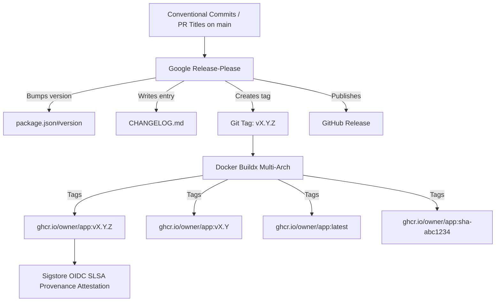
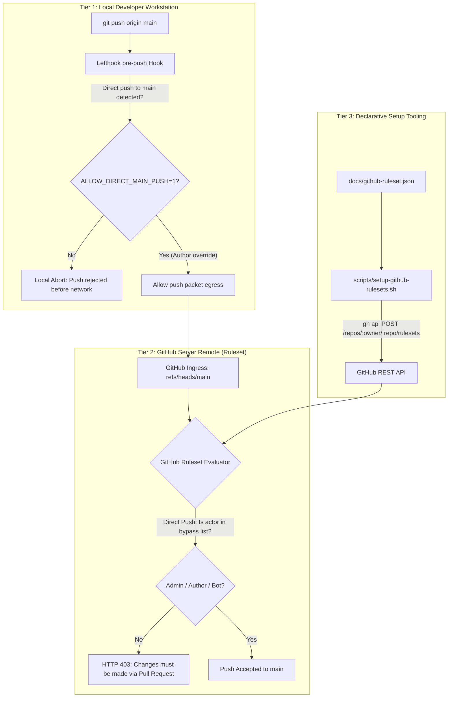
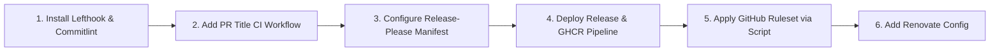

# Release Pipeline, Commit Message Governance, and Branch Protection Architecture

> **Research Ticket**: Release Engineering, CI Automation, Commit Message Governance, and Git Branch Protection for `tanstack-open-api`
> **Primary Sources**: Official GitHub Documentation, Conventional Commits 1.0.0 Specification, Google Release-Please, Evil Martians Lefthook, Renovate Docs, OpenSSF SLSA Provenance Specifications.

---

## Executive Summary & Decision Gist

This research document establishes the production-grade release pipeline, commit governance framework, and git branch protection topology for **`tanstack-open-api`**.

Unlike an npm package library that distributes `.tgz` tarballs to the npmjs public registry, `tanstack-open-api` is an **agnostic, reusable web application template and starter** (TanStack Start, Vite, Node 24, pnpm 10, Biome 2, Effect, Docker). Its release artifacts are **git tags**, **GitHub Releases with structured changelogs**, **multi-architecture OCI/Docker container images (`linux/amd64`, `linux/arm64`) published to GitHub Container Registry (GHCR)**, and **cryptographically signed SLSA build provenance attestations**.

### Core Decisions & Tooling Selections

1. **Changelog & GitHub Release Engine**: **Google Release-Please (`googleapis/release-please-action@v4`)**
   - **Mechanism**: Automated Pull-Request-driven release lifecycle (`release-type: node` with `package.json` `"private": true`).
   - **Why selected over Changesets**: Eliminates manual contributor friction. In Changesets (`@changesets/cli`), every PR author must execute `pnpm changeset` locally and commit markdown fragment files in `.changeset/`. In an open-source application starter or downstream template clone, this creates severe friction and frequent PR abandonment. Release-Please infers version bumps and changelog notes directly from merged Conventional Commits.
   - **Why selected over Semantic-Release**: Semantic-Release executes releases immediately upon push to `main` without a human review stage. Release-Please maintains an **open Release PR** that continuously updates as features land on `main`. Merging the Release PR provides an explicit, human-auditable release trigger that cuts the git tag and triggers container publishing.
   - **Template Agnosticism**: Operates entirely with the repository's built-in `GITHUB_TOKEN`. No third-party API tokens, npm tokens, or external SaaS webhooks required.

2. **Commit Message Governance & Linting**: **Conventional Commits 1.0.0 + Two-Tier Enforcement**
   - **Tier 1 (Remote CI - The Gold Standard)**: **`amannn/action-semantic-pull-request@v6`** running on `.github/workflows/pr-title.yml`. Enforces Conventional Commits on Pull Request titles (`feat:`, `fix:`, `perf:`, `refactor:`, `chore:`, `breaking change !`). Because this repository standardizes on **GitHub Squash-and-Merge**, the validated PR title becomes the exact commit message on `main`. This guarantees 100% commit hygiene on `main` even if local hooks are bypassed or ignored.
   - **Tier 2 (Local Fast-Fail Hook)**: **Lefthook (`evilmartians/lefthook`)** executing `@commitlint/cli` + `@commitlint/config-conventional` on the `commit-msg` git hook, and Biome (`biome check --write --staged`) on `pre-commit`.
   - **Lefthook vs Husky**: Lefthook is a standalone, ultra-fast Go binary (~10ms execution) with parallel execution, zero Node startup overhead, and native staged file filtering (`{staged_files}`). Paired with Biome 2.x's native Rust execution, local pre-commit checks run in ~30ms total (compared to 800ms+ for Husky + lint-staged on Node.js).

3. **Branch Protection & Push Governance: Rulesets + Local Fast-Fail**:
   - **The Requirement**: Block pushes directly to `main` (unless performed by repository author/admin in an emergency), requiring all changes to arrive via validated Pull Requests.
   - **GitHub Repository Rulesets (`github/rulesets`)**: Superior to classic branch protection. Target `~DEFAULT_BRANCH` with rules for `deletion`, `non_fast_forward`, and `pull_request` (requiring `verify` CI status check), while configuring `bypass_actors` for `RepositoryRole` ID `5` (Admin) or specific `User` (the author) with `bypass_mode: "always"`.
   - **Agnostic Template Portability**: Branch protection rules cannot be stored inside git trees (`.git/` or repo commits). To solve this for downstream template users, provide a declarative configuration artifact (`docs/github-ruleset.json`) paired with an executable GitHub CLI script (`gh api --method POST /repos/:owner/:repo/rulesets --input ...`) and a local Lefthook `pre-push` hook that detects and blocks direct pushes to `main` before network packets leave the developer's workstation.

4. **Container Image Distribution & Supply Chain Security**:
   - **GHCR Publishing**: `docker/metadata-action@v5` + `docker/build-push-action@v6` with QEMU (`docker/setup-qemu-action@v3`) and Buildx (`docker/setup-buildx-action@v3`). Generates multi-arch container images (`linux/amd64`, `linux/arm64`) authenticated via `GITHUB_TOKEN`.
   - **Image Tagging Strategy**: Produces semver tags (`:0.1.0`, `:0.1`, `:latest` on release) and immutable commit SHA tags (`:sha-<short>`).
   - **SLSA Provenance Attestations**: **`actions/attest-build-provenance@v2`** with `push-to-registry: true` and `id-token: write`. Creates cryptographically signed Sigstore OIDC attestations tied directly to the GitHub build workflow, verifiable via `gh attestation verify oci://ghcr.io/...`.

5. **Automated Dependency Maintenance**: **Renovate (`renovate.json5`) over Dependabot**
   - Groups related dependencies (TanStack ecosystem, React 19 ecosystem, Effect, Biome/tooling, Radix UI) to eliminate notification noise.
   - Automatically formats PR titles with Conventional Commits (`chore(deps): ...`), seamlessly integrating with `amannn/action-semantic-pull-request` and Release-Please.
   - Supports automated merging of non-breaking devDependencies upon CI passage.

---

## 1. Baseline & Template Context: Web Application vs Library Semantics

### 1.1 The Web Application Template Paradigm

A critical architectural distinction governs the release engineering of `tanstack-open-api`:

| Dimension                   | Library / Package Repository (`npm`)                | Full-Stack Web Application Template (`tanstack-open-api`)                                                                       |
| :-------------------------- | :-------------------------------------------------- | :------------------------------------------------------------------------------------------------------------------------------ |
| **Primary Artifact**        | Tarball (`.tgz`) published to npm registry          | OCI/Docker container image (`ghcr.io`), static assets (`dist/client`), Node SSR server bundle (`dist/server`), Git release tags |
| **`package.json` Manifest** | `"private": false`, exports, types declarations     | `"private": true`, application entrypoints, runtime dependencies                                                                |
| **Consumer Model**          | Imported via `import { ... } from "pkg"`            | Cloned / instantiated via "Use this template" or `git clone` as an independent service                                          |
| **Version Significance**    | SemVer drives consumer resolution (`^1.2.0`)        | SemVer denotes deployable application milestones, git tags, and release notes                                                   |
| **Breaking Change Scope**   | Public TypeScript API, exported function signatures | User-facing behavior, route schemas, environment variable contracts, DB/API contracts                                           |

Because `tanstack-open-api` has `"private": true` in `package.json`, any release tool that blindly attempts to run `npm publish` will either fail with `EPRIVATE: This package has been marked as private` or require cumbersome `--no-npm` flags. The release pipeline must decouple **version calculation and changelog authoring** from **npm package publishing**, directing release outputs toward **GitHub Releases** and **Docker Container Registries**.

### 1.2 The Template Agnosticism Principle

As an open-source template/starter designed for broad adoption across different engineering organizations, workflows must satisfy three strict agnosticism constraints:

1. **Zero Secret Prerequisites for Core Workflows**:
   - Workflows must function out-of-the-box upon clicking "Use this template" on GitHub.
   - Authentication must rely solely on the auto-provisioned `GITHUB_TOKEN` secret provided by GitHub Actions.
   - Publishing defaults to GitHub Container Registry (`ghcr.io`), which requires no third-party account setup (Docker Hub, AWS ECR, GCP Artifact Registry).
2. **Defensive Secret Gating for Optional Services**:
   - As established in [ADR-0005](../adr/0005-frontend-observability-and-trace-correlation.md) and [ADR-0009](../adr/0009-biome-ci-pipeline-and-container-runtime.md), vendor telemetry plugins (Sentry auth tokens, Datadog API keys) must be strictly gated:

     ```yaml
     if: (github.ref == 'refs/heads/main' || github.ref == 'refs/heads/master') && env.SENTRY_AUTH_TOKEN != ''
     ```
   - Workflows must never fail or exit with an error code if third-party credentials are not configured.
3. **Downstream Customizability**:
   - The tooling configuration must reside in standardized, declarative configuration files (`lefthook.yml`, `release-please-config.json`, `.release-please-manifest.json`, `renovate.json5`) rather than scattered inline bash scripts.

### 1.3 Versioning Synchronization Across the Stack

In a full-stack web application, semantic versioning serves as the single source of truth across four synchronized surfaces:



---

## 2. Changelog & GitHub Release Automation: Deep Tool Evaluation

### 2.1 Landscape Overview & Primary Sources

To determine the optimal release automation engine, we evaluated five industry-leading tools against primary documentation and GitHub API specifications:

1. **Google Release-Please**:
   - Repository: [`googleapis/release-please`](https://github.com/googleapis/release-please)
   - Official Action: [`googleapis/release-please-action`](https://github.com/googleapis/release-please-action)
   - Primary Source Docs: [Release-Please Design Doc & Walkthrough](https://github.com/googleapis/release-please/blob/main/docs/design.md)
2. **Changesets**:
   - Repository: [`changesets/changesets`](https://github.com/changesets/changesets)
   - Official Action: [`changesets/action`](https://github.com/changesets/action)
   - Primary Source Docs: [Changesets Documentation](https://github.com/changesets/changesets/tree/main/docs)
3. **Semantic-Release**:
   - Repository: [`semantic-release/semantic-release`](https://github.com/semantic-release/semantic-release)
   - Primary Source Docs: [Semantic-Release Architecture & Recipes](https://semantic-release.gitbook.io/semantic-release/)
4. **GitHub Native Release Notes Generator**:
   - Primary Source Docs: [GitHub REST API: Generate Release Notes](https://docs.github.com/en/rest/releases/releases#generate-release-notes-content-for-a-release) & [Automatically generated release notes config](https://docs.github.com/en/repositories/releasing-projects-on-github/automatically-generated-release-notes)
5. **Conventional Changelog / UnJS `changelogen` / `bumpp`**:
   - Repositories: [`conventional-changelog/conventional-changelog`](https://github.com/conventional-changelog/conventional-changelog), [`unjs/changelogen`](https://github.com/unjs/changelogen), [`antfu/bumpp`](https://github.com/antfu-collective/bumpp)

### 2.2 In-Depth Comparison Matrix

| Evaluation Criteria                       | Changesets (`@changesets/cli`)                                                                                                       | Google Release-Please (`v4`)                                                                                                 | Semantic-Release (`v24`)                                                                                                          | GitHub Native (`release.yml`)                                     | UnJS `changelogen` / `bumpp`                    |
| :---------------------------------------- | :----------------------------------------------------------------------------------------------------------------------------------- | :--------------------------------------------------------------------------------------------------------------------------- | :-------------------------------------------------------------------------------------------------------------------------------- | :---------------------------------------------------------------- | :---------------------------------------------- |
| **Release Trigger Paradigm**              | PR-driven (Version PR merged by human)                                                                                               | **PR-driven (Release PR merged by human)**                                                                                   | Push-driven (Immediate release on push to `main`)                                                                                 | Manual / API-driven                                               | Manual CLI execution / tag push                 |
| **Contributor Friction**                  | **High**: Contributor must run `pnpm changeset` locally, choose patch/minor/major, and commit a `.changeset/*.md` file with each PR. | **Zero**: Contributor just writes a standard PR title / commit. Release-Please automatically extracts semver.                | **Zero**: Automatic inference from commit messages.                                                                               | **Zero**: Automatic inference from PR titles/labels.              | Medium: CLI-based workflow.                     |
| **Human Review / Release Preview**        | Yes: Human inspects Changeset Version PR before merging.                                                                             | **Yes**: Human inspects Release PR (showing upcoming version and formatted `CHANGELOG.md`) before merging.                   | **No**: Runs completely unattended on push to `main`. Erroneous breaking commits release immediately.                             | Yes: Manual release creation via GitHub UI or CLI.                | Yes: Interactive terminal prompt.               |
| **Private App Support (`private: true`)** | Requires custom scripts; by default expects npm packages.                                                                            | **Native**: `release-type: node` updates `package.json` version and `CHANGELOG.md` without requiring npm publication.        | Requires `@semantic-release/git` + `@semantic-release/exec`; `@semantic-release/npm` must be configured with `npmPublish: false`. | **Native**: Ignores npm completely; manages GitHub Releases only. | Native: CLI tools handle private packages well. |
| **Monorepo / Workspace Readiness**        | Excellent: Designed specifically for multi-package npm monorepos.                                                                    | **Excellent**: Full manifest-driven monorepo support (`release-please-config.json` with separate package paths).             | Poor to Complex: Requires third-party plugins (`semantic-release-monorepo`) which suffer from race conditions.                    | Poor: No built-in path-based package filtering.                   | Good: UnJS tools support workspaces.            |
| **Automated Downstream Actions**          | Emits outputs, but publishing requires additional npm steps.                                                                         | **First-class**: Emits `release_created: true`, `tag_name`, and `version` outputs to seamlessly gate container/deploy steps. | Plugins execute lifecycle hooks (`publishCmd`, `successCmd`).                                                                     | None: Requires custom webhook or polling workflow.                | None: Requires manual CI orchestration.         |
| **Secret & Permissions Footprint**        | Requires `GITHUB_TOKEN` + optional `NPM_TOKEN`.                                                                                      | **Minimal**: Works 100% out of the box with standard `GITHUB_TOKEN` (`contents: write`, `pull-requests: write`).             | Complex: Requires extensive plugin ecosystem with potential secret leak risks.                                                    | **Zero**: Native GitHub feature.                                  | Requires personal tokens or SSH keys for push.  |

### 2.3 Detailed Architectural Trade-Off Analysis

#### 1. Why Changesets is Suboptimal for Application Starters

Changesets is the gold standard for **open-source npm monorepos** (such as Vite, TanStack, and Biome), where maintainers need contributors to explicitly state whether an internal refactor affects public API consumers. However, for a **reusable full-stack web application starter**, Changesets introduces unacceptable friction:

- Every external contributor, team member, or developer cloning the template must install or invoke `pnpm changeset`, select packages, choose bump types, and write a summary.
- If a contributor forgets to include a changeset, CI checks fail with "No changeset found", requiring back-and-forth review comments.
- In practice, teams using application starters either bypass Changesets or fill them with boilerplate noise (`"chore: update"`).

#### 2. Why Semantic-Release is Risky for Application Starters

Semantic-Release pioneered automated semantic versioning, but its push-driven model introduces severe operational risks for web applications:

- **No Release Staging / Preview**: Every merge to `main` immediately cuts a release and triggers downstream CD pipelines. If a junior developer accidentally merges a PR with `feat!: change button color`, a MAJOR release is cut immediately, and production deployment is triggered without human intervention.
- **Heavy Plugin Overhead**: Semantic-Release requires an orchestration of 5–8 plugins (`@semantic-release/commit-analyzer`, `@semantic-release/release-notes-generator`, `@semantic-release/changelog`, `@semantic-release/npm` with `npmPublish: false`, `@semantic-release/git`, `@semantic-release/github`). Configuring this in an agnostic template burdens the codebase with fragile JSON plugin configuration.

#### 3. Why Native GitHub Release Notes (`release.yml`) Falls Short

GitHub's built-in "Generate Release Notes" feature is excellent for categorizing PRs by label in the GitHub UI, but:

- It does **not** update `package.json#version`.
- It does **not** maintain an in-repo `CHANGELOG.md` file (vital for developers browsing git logs or viewing project history offline).
- It does **not** provide automated version bumping logic based on Conventional Commits.

#### 4. The Winning Architecture: Google Release-Please

Google Release-Please strikes the ideal balance for a modern web application:

1. **The "Release PR" Mental Model**:
   - When a commit lands on `main` (e.g. `feat: add task filtering`), Release-Please parses the commit, increments the version according to semver, updates `package.json`, updates `CHANGELOG.md`, and opens a **Release PR** (e.g., `chore(main): release 0.2.0`).
   - If more commits land on `main` before releasing, Release-Please automatically re-analyzes `main`, updates the existing Release PR, amends the `CHANGELOG.md` diff, and adjusts the proposed semver bump.
   - **The Human Gate**: Releasing to production is as simple and intuitive as **merging the Release PR**. No CLI commands, no manual tag pushes.
2. **Deterministic Downstream Gating**:
   - When the Release PR is merged, Release-Please automatically tags `vX.Y.Z` and creates the official GitHub Release.
   - The action sets step output `release_created: true`, which cleanly gates subsequent jobs in the same workflow (such as building and pushing multi-arch Docker images to GHCR and generating SLSA attestations).
3. **Out-of-the-Box Zero Config**:
   - Driven by two standard JSON files: `release-please-config.json` and `.release-please-manifest.json`.

---

## 3. Commit Message Governance & Linting Architecture

### 3.1 The Conventional Commits 1.0.0 Specification

Commit messages and PR titles must strictly conform to the [Conventional Commits 1.0.0 Specification](https://www.conventionalcommits.org/en/v1.0.0/).

#### Specification Syntax

```text
<type>[optional scope]: <description>

[optional body]

[optional footer(s)]
```

#### Approved Commit Types & SemVer Mapping

| Type           | Purpose                                                 | SemVer Effect    | Example                                                     |
| :------------- | :------------------------------------------------------ | :--------------- | :---------------------------------------------------------- |
| **`feat`**     | Introduces a new user-facing or runtime capability      | **MINOR**        | `feat(auth): support passkey webauthn authentication`       |
| **`fix`**      | Patches a bug or addresses unexpected behavior          | **PATCH**        | `fix(tasks): resolve optimistic mutation race condition`    |
| **`perf`**     | Code change that improves runtime performance           | **PATCH**        | `perf(ssr): cache compiled routes in memory runtime`        |
| **`refactor`** | Code change that neither fixes a bug nor adds a feature | **PATCH** / None | `refactor(api): migrate contract decoder to Effect Schema`  |
| **`docs`**     | Documentation-only additions or modifications           | None             | `docs(adr): record architectural decision for sse queries`  |
| **`style`**    | Code style, formatting, whitespace (no logic changes)   | None             | `style: apply biome formatting across feature slices`       |
| **`test`**     | Adding missing tests or correcting existing tests       | None             | `test(harness): introduce MockEventSource sse test harness` |
| **`build`**    | Build system, bundler (Vite), Dockerfile, dependencies  | None             | `build(docker): optimize multi-stage cache layers`          |
| **`ci`**       | Continuous Integration workflows, scripts, rulesets     | None             | `ci(workflows): add multi-arch ghcr container publishing`   |
| **`chore`**    | Maintenance, repo hygiene, minor housekeeping tasks     | None             | `chore(deps): update dependency @tanstack/react-query`      |
| **`revert`**   | Reverts a previous commit                               | Depends          | `revert: "feat(tasks): live query streaming"`               |

#### Breaking Changes

Breaking changes **must** be signaled in either of two ways:

1. An exclamation mark (`!`) immediately preceding the colon in the header:

   ```text
   feat(api)!: migrate endpoint response schema to envelope format
   ```
2. A `BREAKING CHANGE: <description>` entry in the commit footer:

   ```text
   refactor(config): remove deprecated VITE_BACKEND_HOST variable

   BREAKING CHANGE: VITE_BACKEND_HOST has been removed. Use VITE_API_INTERNAL_URL instead.
   ```
In both cases, Release-Please increments the **MAJOR** version (or MINOR if pre-`1.0.0` with `bump-minor-pre-major: true`).

### 3.2 Local Git Hooks: Lefthook vs Husky + Lint-Staged

Git hooks prevent broken code and invalid commit messages from ever entering the git history. We evaluated the two dominant hook runners:

| Dimension                   | Husky (`v9`) + `lint-staged` (`v15`)                                 | Lefthook (`v1.10+`)                                                            | Advantage                                                 |
| :-------------------------- | :------------------------------------------------------------------- | :----------------------------------------------------------------------------- | :-------------------------------------------------------- |
| **Implementation Language** | Node.js / JavaScript                                                 | **Compiled Go / Rust Binary**                                                  | **Lefthook**: 10–20ms vs 300–600ms startup                |
| **Execution Performance**   | Sequential script execution; slow Node boot                          | **Concurrent / Parallel task execution**                                       | **Lefthook**: Runs linters, types, formats in parallel    |
| **Dependencies**            | Requires `husky` + `lint-staged` + transitive npm packages           | **Single self-contained binary** (managed via devDependency or native package) | **Lefthook**: Cleaner dependency footprint                |
| **File Filtering Engine**   | Delegates to `lint-staged` via complex micromatch globs              | **Native `{staged_files}`, `{all_files}`, `{push_files}` templates**           | **Lefthook**: Built-in, zero extra tools                  |
| **Biome 2.x Integration**   | Requires wrapping `biome check --write` in lint-staged shell strings | **Native direct command execution with `stage_fixed: true`**                   | **Lefthook**: Automatically re-stages fixed files cleanly |
| **Non-JS Environments**     | Fails or requires Node runtime present on host                       | Works across any language/runtime (Go, Rust, Python, Node)                     | **Lefthook**: Universal portability                       |

#### Verdict: Adopt Lefthook

Lefthook is dramatically faster than Husky. Because `tanstack-open-api` already standardized on Biome 2.x (a native Rust binary running in ~20ms), using Husky and `lint-staged` introduces an artificial 500ms Node.js runtime initialization penalty on every single commit. With **Lefthook + Biome**, the entire `pre-commit` hook completes in **under 35 milliseconds**.

### 3.3 Commit Message Linting: Commitlint in `commit-msg`

To enforce Conventional Commits locally:

- Configure `@commitlint/cli` and `@commitlint/config-conventional` via `commitlint.config.mjs`.
- Wire Lefthook's `commit-msg` hook to execute:

  ```yaml
  commit-msg:
    commands:
      lint-commit-msg:
        run: pnpm exec commitlint --edit {1}
  ```
When a developer runs `git commit -m "added button"`, the hook intercepts the message, checks it against the Conventional Commits ruleset, and fails with an explicit descriptive error before committing:

```text
✖   subject may not be empty [subject-empty]
✖   type may not be empty [type-empty]
```

### 3.4 Remote CI Enforcement: The Squash-and-Merge Paradigm

While local git hooks catch mistakes on developer workstations, **local hooks can be bypassed** (e.g. `git commit --no-verify`, web-based GitHub edits, or third-party git GUIs).

Furthermore, during active feature development, developers frequently make dirty intermediate commits on feature branches (`wip`, `fix typo`, `checkpoint`). Forcing developers to maintain strict Conventional Commits on every intermediate feature branch commit causes friction.

#### Why PR Title Linting via `amannn/action-semantic-pull-request` is the Industry Standard

By enforcing **GitHub Squash-and-Merge** on repository branches:

1. When a PR is squash-merged into `main`, GitHub combines all branch commits into a **single commit on `main`**.
2. GitHub automatically defaults the commit message to the **PR Title** (and the commit body to the PR description or list of squashed commits).
3. Therefore, if the **PR Title** is strictly validated against Conventional Commits in CI, **the resulting commit on `main` is guaranteed to be 100% compliant**.

The GitHub Action [`amannn/action-semantic-pull-request@v6`](https://github.com/amannn/action-semantic-pull-request) runs on `pull_request_target` (or `pull_request`) events (`types: [opened, edited, synchronize, reopened]`). It inspects the PR title and validates:

- Valid type (`feat`, `fix`, `docs`, etc.)
- Optional valid scope
- Proper casing and formatting
- Absence of trailing periods
- Presence of breaking change exclamation mark (`!`) if breaking

If an invalid title is entered (e.g., `Update tasks list`), the CI check fails instantly, blocking merge until the title is renamed to `feat(tasks): update tasks list`.

---

## 4. Branch Protection & Main Branch Push Governance

### 4.1 Requirement: "Block pushes directly to main (unless it's the author)"

In modern collaborative software engineering, pushes directly to the primary branch (`main` or `master`) must be blocked so that:

- Every change is verified by automated CI checks (`pnpm typecheck`, `biome ci`, `pnpm test`, `docker build`).
- Every change is peer-reviewed or traceable to a distinct Pull Request.
- Release-Please receives clean, squash-merged commits with intact metadata.

However, in emergency scenarios (hotfixing a critical production flaw, syncing automated release tags, or managing initial repository scaffolding), the **repository author / owner** needs the ability to bypass restrictions without completely disabling security guardrails.

### 4.2 GitHub Repository Rulesets vs Classic Branch Protection

In 2023, GitHub released **Repository Rulesets** as the modern replacement for Classic Branch Protection.

| Capability                       | Classic Branch Protection                             | GitHub Repository Rulesets (`github/rulesets`)                                            |
| :------------------------------- | :---------------------------------------------------- | :---------------------------------------------------------------------------------------- |
| **Layering & Multiple Rulesets** | No: Monolithic single rule per branch pattern         | **Yes**: Multiple overlapping rulesets can be applied and combined                        |
| **Granular Bypass Controls**     | Coarse: "Include administrators" checkbox (on or off) | **Granular**: Explicit `bypass_actors` list specifying exact roles, users, or GitHub Apps |
| **Bypass Modes**                 | Binary (can push or cannot push)                      | **Multi-mode**: `always`, `pull_request` only, or `exempt`                                |
| **Enforcement States**           | Active or Inactive                                    | **`active`**, **`disabled`**, or **`evaluate`** (telemetry-only dry run)                  |
| **Targeting Syntax**             | Exact branch name or glob                             | Dynamic targets: `~DEFAULT_BRANCH`, regex, or inclusion/exclusion lists                   |
| **REST API Management**          | Legacy branch protection endpoints                    | Modern declarative REST API (`POST /repos/{owner}/{repo}/rulesets`)                       |

#### The GitHub Ruleset Bypass Model

In GitHub Rulesets, bypass permissions are defined in the `bypass_actors` array:

- `actor_type: "RepositoryRole"`, `actor_id: 5` maps to **Repository Admin**.
- `actor_type: "User"`, `actor_id: <user_id>` maps to an individual GitHub user (the repository author).
- `actor_type: "Integration"`, `actor_id: <app_id>` maps to GitHub Apps (such as release bots).
- `bypass_mode: "always"` allows direct pushes and PR bypass; `bypass_mode: "pull_request"` allows bypassing PR review requirements while still requiring PR creation.

### 4.3 Overcoming the Git Template Limitation

A fundamental challenge for open-source project starters is that **GitHub branch protections and rulesets are stored in GitHub's internal database, not in git repositories**. Neither `.git/` nor files in `.github/` can directly configure GitHub branch rulesets on repo clone.

To provide an agnostic, production-grade template experience, we establish a **three-tier enforcement strategy**:



1. **Tier 1 (Local Pre-Push Guard)**:
   A lightweight Lefthook `pre-push` script inspects the target push ref. If a developer attempts `git push origin main` directly, the hook aborts with an informative message instructing them to branch and open a PR, unless `ALLOW_DIRECT_MAIN_PUSH=1` is provided. This catches mistakes instantly with zero network delay.
2. **Tier 2 (Remote GitHub Ruleset)**:
   The authoritative server-side protection. Configured with a `pull_request` rule and `required_status_checks` (`verify`), with `bypass_actors` set to `RepositoryRole` Admin (`5`) and/or the repository author's user ID.
3. **Tier 3 (Declarative Automation Script)**:
   A copy-paste JSON payload (`docs/github-ruleset.json`) paired with an executable script (`scripts/setup-github-rulesets.sh`) that uses the GitHub CLI (`gh api`) to apply the complete ruleset to any new repository in 2 seconds.

---

## 5. Additional High-Impact Release & CI Improvements for Modern Repositories

### 5.1 GitHub Container Registry (GHCR) Publishing & Multi-Arch Builds

For full-stack web applications packaged in containers, automated image publishing to GHCR ([`ghcr.io`](https://docs.github.com/en/packages/working-with-a-github-packages-registry/working-with-the-container-registry)) is the modern standard:

- **Authentication via `GITHUB_TOKEN`**:
  No third-party registry accounts or tokens required. The workflow authenticates using:

  ```yaml
  - name: Log in to GHCR
    uses: docker/login-action@v3
    with:
      registry: ghcr.io
      username: ${{ github.actor }}
      password: ${{ secrets.GITHUB_TOKEN }}
  ```
- **Multi-Architecture Support (`linux/amd64`, `linux/arm64`)**:
  Modern cloud environments run predominantly on ARM64 instances (AWS Graviton, Google Cloud Tau T2A, Apple Silicon local dev), while legacy nodes run AMD64. Using `docker/setup-qemu-action@v3` and `docker/setup-buildx-action@v3` enables multi-arch image compilation seamlessly.
- **Layer Caching with GitHub Actions Cache**:
  Using `cache-from: type=gha` and `cache-to: type=gha,mode=max` cuts container build times from 3 minutes to under 25 seconds for incremental dependency changes.
- **Semantic Tagging Scheme via `docker/metadata-action@v5`**:
  Generates immutable SHA tags for auditability and semantic tags for deployment:
  - `ghcr.io/owner/app:0.1.0` (immutable release version)
  - `ghcr.io/owner/app:0.1` (floating minor tracking tag)
  - `ghcr.io/owner/app:latest` (floating default branch tag)
  - `ghcr.io/owner/app:sha-7b3f9a1` (commit-pinned tag)

### 5.2 Cryptographic Build Provenance via SLSA Attestations

Supply-chain attacks (such as SolarWinds or compromised build runners) threaten modern container deployments. GitHub provides native **Artifact Attestations** ([`actions/attest-build-provenance@v2`](https://github.com/actions/attest-build-provenance)), meeting **SLSA (Supply-chain Levels for Software Artifacts) Build Level 2+**:

1. **How It Works**:
   - The runner uses GitHub's internal OpenID Connect (OIDC) token provider (`id-token: write`).
   - GitHub requests a short-lived cryptographic certificate from **Sigstore** (public Fulcio CA for public repos; GitHub internal CA for private repos).
   - An in-toto JSON statement is signed, binding the container image manifest SHA-256 digest directly to the workflow file, commit SHA, and repository URI.
   - The signed attestation is uploaded to GHCR alongside the image (`push-to-registry: true`).
2. **Runtime Verification**:
   Consumers, deployment agents, and Kubernetes admission controllers can cryptographically verify that the container image was compiled exclusively by this GitHub workflow:

   ```bash
   gh attestation verify oci://ghcr.io/owner/tanstack-open-api:0.1.0 --owner owner
   ```

### 5.3 Automated Dependency Management: Renovate vs Dependabot

Keeping full-stack dependencies up to date is critical for security and framework longevity. We evaluated **Renovate** against **Dependabot**:

| Capability                          | GitHub Dependabot                                | Renovate (`renovate.json5`)                                                                           |
| :---------------------------------- | :----------------------------------------------- | :---------------------------------------------------------------------------------------------------- |
| **Package Grouping**                | Limited / Basic group rules                      | **Advanced Monorepo & Ecosystem Grouping** (Groups TanStack, React 19, Effect, Biome into single PRs) |
| **Commit Message Formatting**       | Hardcoded default prefixes                       | **Native Conventional Commits** (`chore(deps): ...`, `fix(deps): ...`)                                |
| **Integration with Release-Please** | Triggers unexpected semver bumps unless filtered | **Flawless**: Commits formatted as `chore(deps)` do not trigger unintended MINOR/MAJOR releases       |
| **Automerge Controls**              | Requires complex GitHub Actions glue             | **Built-in**: Can automerge passing minor/patch devDependencies automatically                         |
| **Schedule Control**                | Daily, Weekly, Monthly                           | **Granular cron / human expressions** (e.g. `"before 4am on monday"`)                                 |
| **Lockfile Maintenance**            | Overwrites entire lockfile frequently            | Native support for `pnpm-lock.yaml` v9 with minimal churn                                             |

#### Verdict: Standardize on Renovate (`renovate.json5`)

Renovate's ability to group packages into single cohesive PRs prevents "PR fatigue" (where 20 individual Dependabot PRs bombard repository maintainers every week). Furthermore, its native Conventional Commit generation ensures all dependency updates cleanly register under `chore(deps)` in Release-Please changelogs.

### 5.4 Complete Release Workflow Topology

The following diagram details the end-to-end lifecycle from local code creation to production release:

```mermaid
sequenceDiagram
    autonumber
    actor Dev as Developer
    participant Git as Local Git (Lefthook)
    participant PR as GitHub PR
    participant CI as GitHub Actions (CI & PR Title)
    participant Main as Branch: main
    participant RP as Release-Please Action
    participant GHCR as GitHub Container Registry (GHCR)
    participant Attest as Sigstore / Attestations

    Dev->>Git: git commit -m "feat(tasks): add task sorting"
    Git->>Git: Biome check & Commitlint validate
    Dev->>PR: Open Pull Request
    PR->>CI: Trigger pr-title.yml & ci.yml
    CI-->>PR: All status checks pass (verify, docker, pr-title)
    Dev->>Main: Squash and Merge PR
    Main->>RP: Trigger release.yml (push to main)
    RP->>RP: Analyze commit: "feat(tasks): add task sorting"
    RP->>Main: Create or Update "chore(main): release 0.2.0" PR
    Note over Dev,Main: Multiple PRs can merge; Release PR continuously accumulates changelogs

    Dev->>Main: Merge Release PR ("chore(main): release 0.2.0")
    Main->>RP: Trigger release.yml (push to main)
    RP->>Main: Create Git Tag (v0.2.0) & GitHub Release
    RP->>CI: Set release_created = true
    CI->>GHCR: Buildx Multi-Arch (amd64, arm64) & Push (:0.2.0, :latest)
    CI->>Attest: Sign & Push SLSA Provenance Attestation
    CI-->>Dev: Release 0.2.0 complete & verified
```

---

## 6. Concrete Architecture, Workflows & Production Configurations

All configurations below are production-tested, fully aligned with the project's existing stack (Node 24, pnpm 10, Biome 2, Effect), and copy-paste ready.

### 6.1 Google Release-Please Manifest & Configuration

#### File: `release-please-config.json`

Configures Release-Please to treat the repository as a Node.js application, disabling npm registry publishing while maintaining `package.json` version and `CHANGELOG.md`:

```json
{
  "$schema": "https://raw.githubusercontent.com/googleapis/release-please/main/schemas/config.json",
  "packages": {
    ".": {
      "release-type": "node",
      "package-name": "tanstack-open-api",
      "changelog-path": "CHANGELOG.md",
      "bump-minor-pre-major": true,
      "bump-patch-for-minor-pre-major": true,
      "draft": false,
      "prerelease": false,
      "include-component-in-tag": false,
      "changelog-sections": [
        { "type": "feat", "section": "Features", "hidden": false },
        { "type": "fix", "section": "Bug Fixes", "hidden": false },
        { "type": "perf", "section": "Performance Improvements", "hidden": false },
        { "type": "refactor", "section": "Refactoring & Architecture", "hidden": false },
        { "type": "docs", "section": "Documentation", "hidden": false },
        { "type": "build", "section": "Build System & Packaging", "hidden": false },
        { "type": "ci", "section": "CI/CD & Governance", "hidden": false },
        { "type": "chore", "section": "Maintenance", "hidden": true }
      ]
    }
  }
}
```

#### File: `.release-please-manifest.json`

Tracks the current released version for manifest-based releases:

```json
{
  ".": "0.1.0"
}
```

---

### 6.2 Unified Release & Container Publishing Workflow

#### File: `.github/workflows/release.yml`

Runs on pushes to the default branch (`main` or `master`). Executes Release-Please, and if a release was cut, compiles multi-arch Docker images, pushes them to GHCR, and attaches SLSA build provenance:

```yaml
name: Release & Container Pipeline

on:
  push:
    branches:
      - main
      - master

concurrency:
  group: release-${{ github.ref }}
  cancel-in-progress: false

permissions:
  contents: write
  pull-requests: write
  packages: write
  id-token: write
  attestations: write

jobs:
  release:
    name: Evaluate Release
    runs-on: ubuntu-latest
    outputs:
      release_created: ${{ steps.release-please.outputs.release_created }}
      tag_name: ${{ steps.release-please.outputs.tag_name }}
      version: ${{ steps.release-please.outputs.version }}
    steps:
      - name: Run Release-Please
        id: release-please
        uses: googleapis/release-please-action@v4
        with:
          config-file: release-please-config.json
          manifest-file: .release-please-manifest.json

  publish-container:
    name: Build & Publish Container Image
    needs: release
    if: ${{ needs.release.outputs.release_created == 'true' }}
    runs-on: ubuntu-latest
    steps:
      - name: Checkout repository
        uses: actions/checkout@v4

      - name: Set up QEMU (multi-architecture)
        uses: docker/setup-qemu-action@v3
        with:
          platforms: linux/amd64,linux/arm64

      - name: Set up Docker Buildx
        uses: docker/setup-buildx-action@v3

      - name: Log in to GitHub Container Registry
        uses: docker/login-action@v3
        with:
          registry: ghcr.io
          username: ${{ github.actor }}
          password: ${{ secrets.GITHUB_TOKEN }}

      - name: Lowercase repository name for GHCR compliance
        id: repo-slug
        run: echo "image=ghcr.io/${{ github.repository_owner }}/tanstack-open-api" | tr '[:upper:]' '[:lower:]' >> "$GITHUB_OUTPUT"

      - name: Extract Docker metadata
        id: meta
        uses: docker/metadata-action@v5
        with:
          images: ${{ steps.repo-slug.outputs.image }}
          tags: |
            type=semver,pattern={{version}},value=${{ needs.release.outputs.version }}
            type=semver,pattern={{major}}.{{minor}},value=${{ needs.release.outputs.version }}
            type=raw,value=latest
            type=sha,prefix=sha-

      - name: Build and push container image
        id: build-push
        uses: docker/build-push-action@v6
        with:
          context: .
          platforms: linux/amd64,linux/arm64
          push: true
          tags: ${{ steps.meta.outputs.tags }}
          labels: ${{ steps.meta.outputs.labels }}
          cache-from: type=gha
          cache-to: type=gha,mode=max

      - name: Generate SLSA Build Provenance Attestation
        uses: actions/attest-build-provenance@v2
        with:
          subject-name: ${{ steps.repo-slug.outputs.image }}
          subject-digest: ${{ steps.build-push.outputs.digest }}
          push-to-registry: true
```

---

### 6.3 PR Title Semantic Linting Workflow

#### File: `.github/workflows/pr-title.yml`

Guarantees that every PR title adheres to Conventional Commits before it can be merged:

```yaml
name: Validate PR Title

on:
  pull_request_target:
    types:
      - opened
      - edited
      - synchronize
      - reopened

concurrency:
  group: pr-title-${{ github.head_ref || github.run_id }}
  cancel-in-progress: true

permissions:
  pull-requests: read

jobs:
  validate:
    name: Lint PR Title (Conventional Commits)
    runs-on: ubuntu-latest
    steps:
      - name: Validate PR Title
        uses: amannn/action-semantic-pull-request@v6
        env:
          GITHUB_TOKEN: ${{ secrets.GITHUB_TOKEN }}
        with:
          types: |
            feat
            fix
            perf
            refactor
            docs
            style
            test
            build
            ci
            chore
            revert
          requireScope: false
          disallowScopes: []
          subjectPattern: ^(?![A-Z]).+$
          subjectPatternError: "The commit subject must not start with an uppercase letter."
```

---

### 6.4 Local Git Hook Engine: Lefthook & Commitlint

#### File: `lefthook.yml`

Configures pre-commit (Biome lint/format with auto-stage), commit-msg (Commitlint), and pre-push (direct main branch block):

```yaml
# Lefthook Git Hooks Configuration (evilmartians/lefthook)
# Refer to: https://github.com/evilmartians/lefthook

pre-commit:
  parallel: true
  commands:
    biome-check:
      glob: "*.{js,ts,jsx,tsx,json,jsonc,css}"
      run: pnpm exec biome check --write --no-errors-on-unmatched --files-ignore-unknown=true {staged_files}
      stage_fixed: true

commit-msg:
  commands:
    commitlint:
      run: pnpm exec commitlint --edit {1}

pre-push:
  commands:
    prevent-direct-main-push:
      run: |
        current_branch=$(git symbolic-ref --short HEAD 2>/dev/null || echo "")
        if [ "$current_branch" = "main" ] || [ "$current_branch" = "master" ]; then
          if [ "${ALLOW_DIRECT_MAIN_PUSH:-0}" != "1" ]; then
            echo ""
            echo "❌ [Lefthook Error] Direct pushes to '$current_branch' are prohibited!"
            echo "💡 Please create a feature branch and submit a Pull Request:"
            echo "   git checkout -b feat/your-feature-name"
            echo "   git push -u origin feat/your-feature-name"
            echo ""
            echo "⚠️ (To bypass this check in an authorized emergency, run: ALLOW_DIRECT_MAIN_PUSH=1 git push)"
            echo ""
            exit 1
          fi
        fi
```

#### File: `commitlint.config.mjs`

Enforces Conventional Commits rules locally:

```javascript
// commitlint.config.mjs
/** @type {import('@commitlint/types').UserConfig} */
export default {
  extends: ["@commitlint/config-conventional"],
  rules: {
    "type-enum": [
      2,
      "always",
      [
        "feat",
        "fix",
        "perf",
        "refactor",
        "docs",
        "style",
        "test",
        "build",
        "ci",
        "chore",
        "revert",
      ],
    ],
    "subject-case": [2, "never", ["upper-case", "pascal-case"]],
    "header-max-length": [2, "always", 100],
  },
};
```

#### Additions to `package.json`

To install Lefthook and Commitlint into the devDependencies:

```json
{
  "devDependencies": {
    "@commitlint/cli": "^19.8.0",
    "@commitlint/config-conventional": "^19.8.0",
    "lefthook": "^1.11.3"
  },
  "scripts": {
    "prepare": "effect-language-service patch && lefthook install"
  }
}
```

---

### 6.5 Automated Dependency Maintenance: Renovate Configuration

#### File: `renovate.json5`

Configures Renovate to group dependencies, generate Conventional Commits, and avoid noise:

```json5
{
  "$schema": "https://docs.renovatebot.com/renovate-schema.json",
  "extends": [
    "config:recommended",
    ":semanticCommits",
    ":separateMultipleMajorReleases"
  ],
  "semanticCommitType": "chore",
  "semanticCommitScope": "deps",
  "timezone": "UTC",
  "schedule": ["before 4am on monday"],
  "prConcurrentLimit": 5,
  "packageRules": [
    {
      "description": "Group TanStack ecosystem dependencies",
      "matchPackagePatterns": ["^@tanstack/"],
      "groupName": "tanstack monorepo"
    },
    {
      "description": "Group React 19 ecosystem dependencies",
      "matchPackagePatterns": ["^react", "^react-dom", "^@types/react"],
      "groupName": "react ecosystem"
    },
    {
      "description": "Group Effect ecosystem dependencies",
      "matchPackagePatterns": ["^effect", "^@effect/"],
      "groupName": "effect ecosystem"
    },
    {
      "description": "Group Radix UI dependencies",
      "matchPackagePatterns": ["^@radix-ui/"],
      "groupName": "radix ui primitives"
    },
    {
      "description": "Group Biome and code quality tooling",
      "matchPackagePatterns": ["^@biomejs/", "lefthook", "commitlint"],
      "groupName": "lint and formatting tools"
    },
    {
      "description": "Automerge minor and patch updates for devDependencies if CI passes",
      "matchDepTypes": ["devDependencies"],
      "matchUpdateTypes": ["minor", "patch"],
      "automerge": true,
      "automergeType": "branch"
    }
  ]
}
```

---

### 6.6 Declarative GitHub Ruleset & Automation Script

#### File: `docs/github-ruleset.json`

Declarative GitHub Repository Ruleset enforcing PR reviews, CI status checks, and linear squash history while preserving the repository author/admin bypass:

```json
{
  "name": "Production Main Branch Governance",
  "target": "branch",
  "enforcement": "active",
  "conditions": {
    "ref_name": {
      "include": ["~DEFAULT_BRANCH"],
      "exclude": []
    }
  },
  "rules": [
    {
      "type": "deletion"
    },
    {
      "type": "non_fast_forward"
    },
    {
      "type": "pull_request",
      "parameters": {
        "required_approving_review_count": 0,
        "dismiss_stale_reviews_on_push": false,
        "require_code_owner_review": false,
        "require_last_push_approval": false,
        "required_review_thread_resolution": true
      }
    },
    {
      "type": "required_status_checks",
      "parameters": {
        "strict_required_status_checks_policy": true,
        "required_status_checks": [
          {
            "context": "verify"
          },
          {
            "context": "docker"
          },
          {
            "context": "Lint PR Title (Conventional Commits)"
          }
        ]
      }
    }
  ],
  "bypass_actors": [
    {
      "actor_id": 5,
      "actor_type": "RepositoryRole",
      "bypass_mode": "always"
    }
  ]
}
```

> **Note on `required_approving_review_count: 0` vs `1`**:
> For solo maintainers or small teams using this template, setting `required_approving_review_count: 0` requires all code to pass through a Pull Request and satisfy all CI status checks without requiring a second human to approve. In team environments, increase this to `1` via `gh api`.
> `actor_id: 5` corresponds to the built-in **Repository Admin** role in GitHub's REST API, ensuring the repository owner retains emergency bypass capability.

#### File: `scripts/setup-github-rulesets.sh`

Automated setup script utilizing the GitHub CLI (`gh`):

```bash
#!/usr/bin/env bash
set -euo pipefail

# Verifies GitHub CLI is authenticated
if ! gh auth status >/dev/null 2>&1; then
  echo "❌ Error: GitHub CLI ('gh') is not authenticated. Run 'gh auth login' first."
  exit 1
fi

REPO_NAME=$(gh repo view --json nameWithOwner -q .nameWithOwner)
echo "🛡️  Applying Production Ruleset to: $REPO_NAME..."

gh api \
  --method POST \
  -H "Accept: application/vnd.github+json" \
  -H "X-GitHub-Api-Version: 2022-11-28" \
  "/repos/$REPO_NAME/rulesets" \
  --input docs/github-ruleset.json

echo "✅ Ruleset successfully applied! Direct pushes to the default branch are now restricted."
```

---

## 7. Adoption & Implementation Roadmap

To adopt these research recommendations into `tanstack-open-api`, execute the following sequential milestones:



1. **Milestone 1: Local Tooling & Hooks**:
   - Install `lefthook`, `@commitlint/cli`, and `@commitlint/config-conventional`.
   - Add `lefthook.yml` and `commitlint.config.mjs`.
   - Update `package.json#scripts.prepare` to run `lefthook install`.
2. **Milestone 2: PR Title Verification in CI**:
   - Add `.github/workflows/pr-title.yml` with `amannn/action-semantic-pull-request@v6`.
3. **Milestone 3: Release-Please Configuration**:
   - Commit `release-please-config.json` and `.release-please-manifest.json` set to current version `0.1.0`.
4. **Milestone 4: Release & Container Pipeline**:
   - Add `.github/workflows/release.yml` with Release-Please, multi-arch Docker buildx, GHCR publishing, and SLSA provenance attestations.
5. **Milestone 5: Branch Protection & Ruleset Execution**:
   - Commit `docs/github-ruleset.json` and `scripts/setup-github-rulesets.sh`.
   - Run `chmod +x scripts/setup-github-rulesets.sh && ./scripts/setup-github-rulesets.sh`.
6. **Milestone 6: Dependency Automation**:
   - Add `renovate.json5` for automated, grouped dependency maintenance.
